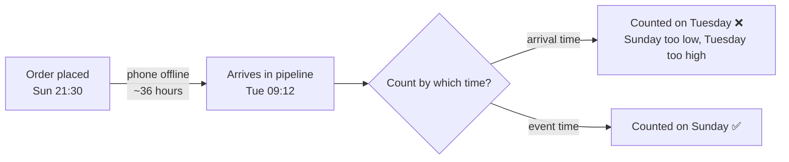

# Day 1 · Late-arriving data

!!! abstract "In one line"
    Data often reaches your system **after** the moment it describes. If you count it by when it *arrived*, yesterday's numbers are wrong, and everything built on them is wrong too.

<span class="dd-fix">event time</span> <span class="dd-fix">watermark</span> <span class="dd-fix">reprocessing</span> <span class="dd-fix">dead-letter</span>

## The story: Raju's Sunday

Raju runs a small shop. Every night he writes the day's total in his notebook. On Sunday night he writes **₹2,00,000**. A bad day, he thinks, so he orders less stock for next week.

But one delivery boy's phone had no network on Sunday. His orders, worth **₹30,000**, only reached Raju on **Tuesday**. Sunday was actually a ₹2,30,000 day.

Raju simply cuts the number in his notebook and fixes it. One notebook, one pen.

**A food delivery app can't do that.** It gets millions of orders, and by Tuesday Sunday's wrong total has already reached dashboards, finance reports and the stock-planning system. Teams have already made decisions on it.

That is **late-arriving data**.

## Why it happens in real systems

| Cause | Example |
|---|---|
| Devices offline | A delivery partner's phone loses network; events are queued and sent later |
| Retries and backlogs | A message queue consumer falls behind or retries after a failure |
| Batch uploads from partners | A payment gateway sends yesterday's settlement file at noon today |
| Time zones and clock skew | An event stamped 23:50 IST lands after midnight UTC processing |
| Backfills and corrections | A source system fixes and re-sends old records |

The key idea is that every record has **two timestamps**:

- **Event time**: when it actually happened (order placed Sunday 21:30).
- **Arrival time** (ingestion or processing time): when your pipeline saw it (Tuesday 09:12).



## Fix 1: Event time

**Raju:** files each receipt by the day of the sale, not the day it reached him.
**The app:** every order carries `event_time`, the moment it was placed, and all daily metrics group by it.

With the sample data in [`code/day-01-late-arriving-data`](https://github.com/datadukaan/datadukaan.github.io/tree/main/code/day-01-late-arriving-data), Sunday is **₹2,00,000** by arrival time but **₹2,30,000** by event time.

??? example "PySpark: event time vs arrival time (`01_event_time_vs_arrival_time.py`)"
    ```python
    --8<-- "day-01-late-arriving-data/01_event_time_vs_arrival_time.py"
    ```

```text
+----------+-------------------+---------------------+
|       day|total_by_event_time|total_by_arrival_time|
+----------+-------------------+---------------------+
|2026-10-25|             230000|               200000|   <- Sunday
|2026-10-26|             103000|                75000|
|2026-10-27|              60000|               127000|   <- Tuesday inflated
+----------+-------------------+---------------------+
```

!!! tip "In practice"
    Make `event_time` a required field in your data contract. Store both timestamps: event time for business metrics, arrival time for debugging and freshness checks.

## Fix 2: Watermark

**Raju:** waits two hours after closing before writing the total, so stragglers can still come in.
**The app:** a streaming job sets a **watermark**, a rule like *"accept events up to 2 hours later than the newest event I've seen; after that, finalise the window."*

```python
daily = (stream
         .withWatermark("event_time", "2 hours")
         .groupBy(F.window("event_time", "1 day"))
         .agg(F.sum("amount")))
```

Without a watermark, a streaming aggregation must keep state for every day forever, waiting for late data. Memory grows without limit. The watermark is how the engine knows when it's safe to close a window and drop its state.

**The trade-off:** anything later than the watermark is **dropped** by the stream. In the demo, an order 35 minutes late is counted, but Sunday's orders that arrived ~36 hours late are not, so the stream still says ₹2,00,000.

| Watermark | Pros | Cons |
|---|---|---|
| Short (minutes) | Fresh results, small state, low cost | More late events dropped |
| Long (days) | Catches more late data | Results finalise slowly, large state, higher cost |

Pick it from data, not guesswork: measure the delay distribution (`arrival_time - event_time`) and choose a value that covers, say, the 99th percentile.

??? example "PySpark Structured Streaming with a watermark (`02_watermark_streaming.py`)"
    ```python
    --8<-- "day-01-late-arriving-data/02_watermark_streaming.py"
    ```

## Fix 3: Reprocessing

**Raju:** every night he rechecks the last three days and fixes any total that changed.
**The app:** a nightly batch job recounts a **lookback window** (e.g. the last 3 days) from raw data by event time and **MERGEs** the results, updating only the days that changed.

This is the safety net behind the watermark: the stream gives fast, approximately right numbers; the nightly reprocessing makes them correct.

=== "Delta Lake / Databricks SQL"
    ```sql
    --8<-- "day-01-late-arriving-data/03_reprocessing_merge_delta.sql"
    ```

=== "Runnable demo (DuckDB)"
    ```python
    --8<-- "day-01-late-arriving-data/03_reprocessing_merge.py"
    ```

=== "dbt incremental model"
    ```sql
    --8<-- "day-01-late-arriving-data/dbt_project/models/daily_sales.sql"
    ```

Result of the nightly job: only Sunday changes, from **₹2,00,000 to ₹2,30,000**.

!!! warning "Make it idempotent"
    Reprocessing must give the same result no matter how many times it runs. That's why it uses `MERGE` (or delete-and-insert of whole days), never a plain `INSERT` that would double count.

## Bonus: Dead-letter table

Some data is *very* late. In the sample, an order from 4 October arrives on 27 October. Silently changing a three-week-old number that's already in a finance report is risky. Instead, events older than the lookback window go to a **dead-letter table** (or dead-letter queue) for a human to review and, if needed, run a targeted backfill.

## When to use what

| Situation | Approach |
|---|---|
| Daily batch reports | Group by event time + lookback reprocessing (Fix 1 + 3) |
| Real-time dashboards | Streaming with a watermark + nightly reprocessing (Fix 1 + 2 + 3) |
| Finance / regulatory numbers | Event time + reprocessing + dead-letter review, and **close periods** explicitly (e.g. month-end lock) |
| ML features | Event time + point-in-time correct joins (no peeking at data that arrived later) |

## Interview questions

??? question "What's the difference between event time and processing time?"
    Event time is when the event actually happened at the source. Processing (or ingestion) time is when the pipeline handled it. Business metrics should use event time; processing time is useful for monitoring freshness and lag.

??? question "What is a watermark in Spark Structured Streaming, and what happens to data later than it?"
    It's a threshold behind the maximum event time seen so far (e.g. `withWatermark("event_time", "2 hours")`). It lets the engine finalise windows and drop old state. Records older than the watermark are not added to already-finalised windows; they're dropped (in append mode) or ignored for that state.

??? question "How would you make sure daily metrics are correct when data arrives up to 3 days late?"
    Aggregate by event time; run a scheduled job that recomputes the last 3 days from raw data and MERGEs/overwrites those partitions idempotently; route anything older to a dead-letter table and alert; monitor the event-to-arrival delay so the lookback window stays big enough.

??? question "Why should reprocessing use MERGE or partition overwrite instead of INSERT?"
    So reruns are idempotent. A plain INSERT appends again on every rerun and double counts; MERGE or partition overwrite replaces the recomputed days.

## Run it yourself

```bash
git clone https://github.com/datadukaan/datadukaan.github.io.git
cd datadukaan.github.io && pip install -r requirements.txt
cd code/day-01-late-arriving-data
python 01_event_time_vs_arrival_time.py   # Fix 1  (needs Java 17+ for PySpark)
python 02_watermark_streaming.py          # Fix 2
python 03_reprocessing_merge.py           # Fix 3 + dead-letter
./dbt_project/run_demo.sh                 # Fix 3 in dbt
```

## Further reading

- [Spark Structured Streaming: handling late data and watermarking](https://spark.apache.org/docs/latest/streaming/apis-on-dataframes-and-datasets.html#handling-late-data-and-watermarking)
- [Delta Lake: upsert into a table using MERGE](https://docs.delta.io/latest/delta-update.html#upsert-into-a-table-using-merge)
- [dbt: configuring incremental models](https://docs.getdbt.com/docs/build/incremental-models)
- Tyler Akidau, *The world beyond batch: Streaming 101 and 102*, O'Reilly Radar, the classic explanation of event time and watermarks.

---

*Watch the 60-second version on [Instagram](https://instagram.com/datadukaan) or [YouTube](https://youtube.com/@datadukaan). Next: [Day 2 · Duplicate data](day-02-duplicate-data.md).*
