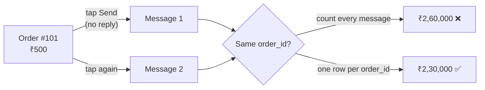

# Day 2 · Duplicate data

!!! abstract "In one line"
    Phones and servers **retry** when they don't hear back, so the same event can arrive twice. If every arrival is counted, totals come out too high, and everything built on them is wrong too.

<span class="dd-fix">unique ID</span> <span class="dd-fix">deduplication</span> <span class="dd-fix">idempotent write</span>

## The story: Raju's "best" Sunday

Sunday looks like Raju's best day ever: **₹2,60,000**. So he orders extra stock.

But real sales were only **₹2,30,000**. A delivery boy on weak network tapped "Send", saw nothing happen, and tapped again. Both messages reached Raju. Same customer, same ₹500.

Raju has a problem: is this **one order sent twice**, or did the customer **really order twice**? He can't tell, so he writes both. ₹30,000 of his Sunday is the same orders, counted twice.

In a shop it's one wrong line in one notebook. **In apps**, phones and servers retry millions of times a day, and the copies flow into payments and reports. That is **duplicate data**.

## Why it happens in real systems

| Cause | Example |
|---|---|
| Client retries | A phone sends an order, the reply times out, the app sends it again |
| At-least-once delivery | Kafka, SQS and Pub/Sub guarantee *at least* once: a consumer that crashes before committing its offset re-reads the same messages |
| Job reruns | An Airflow task fails halfway and is retried, appending the same rows again |
| Re-sent files | A partner uploads yesterday's file again, or the same file lands twice |
| Merged sources | The same customer arrives from the app and from the website |

Most platforms choose at-least-once because the alternative, at-most-once, **loses** data. So duplicates aren't a bug to wish away; the pipeline must expect them.



## Fix 1: Unique ID

**Raju:** puts a number on every bill. A copy carries the **same** number; a new order gets a **new** one.
**The app:** every order gets an `order_id` when it is *created*, on the phone, before the first send. Every retry carries that same ID.

The ID is what separates a **retry** from a **real repeat**. In the [sample data](https://github.com/datadukaan/datadukaan.github.io/tree/main/code/day-02-duplicate-data), customer C01 sends order 101 twice (a retry) and also places order 111 for the same ₹500 later (a real second order). Guessing duplicates by "same customer + same amount" throws away the real order.

??? example "PySpark: why you need the ID (`01_unique_id.py`)"
    ```python
    --8<-- "day-02-duplicate-data/01_unique_id.py"
    ```

```text
Messages received: 12
naive_total: 260000                     <- every message counted
Dedup by (customer_id, amount) - WRONG, drops real order 111:
total: 229500   orders: 9
Copies per order_id:
|order_id|customer_id|amount|count|
|     105|        C05| 29500|    2|
|     101|        C01|   500|    2|
real_orders: 10
```

!!! tip "In practice"
    Generate the ID where the event is born (a UUID on the client, or an *idempotency key* in the API request), never at the database. An ID created after arrival is new for every copy and can't catch anything.

## Fix 2: Deduplication

**Raju:** before writing, checks "Is bill 101 **already here**?" If yes, he skips it.
**The app:** keeps one row per `order_id`.

In batch, use a window function and pick a rule for which copy wins (first received, latest version). A bare `dropDuplicates` keeps an arbitrary copy, which matters when copies differ.

??? example "PySpark: one row per order (`02_deduplication.py`)"
    ```python
    --8<-- "day-02-duplicate-data/02_deduplication.py"
    ```

```text
+------+------+
| total|orders|
+------+------+
|230000|    10|
+------+------+
```

In **streaming**, the job can't remember every ID forever. `dropDuplicatesWithinWatermark(["order_id"])` (Spark 3.5+) keeps IDs only as long as a retry can plausibly arrive; the watermark from [Day 1](day-01-late-arriving-data.md) decides how long.

| Where you dedupe | Pros | Cons |
|---|---|---|
| In the batch (window / `QUALIFY`) | Simple, exact | Only catches duplicates *within* that batch |
| Against the target table (MERGE, Fix 3) | Catches copies across runs | Needs a key and a join on every load |
| In the stream (within watermark) | Clean data in seconds | Copies later than the watermark slip through |

## Fix 3: Idempotent write

**Raju:** if bill 101 arrives again, he doesn't add a new line. He **updates** the old one. Once or ten times, the total stays the same.
**The app:** writes with an **upsert** keyed on `order_id`: update the row if it exists, insert it if it doesn't. Running the same load again changes nothing. That property is called **idempotency**.

=== "Delta Lake / Databricks SQL"
    ```sql
    --8<-- "day-02-duplicate-data/03_idempotent_write_delta.sql"
    ```

=== "Runnable demo (DuckDB)"
    ```python
    --8<-- "day-02-duplicate-data/03_idempotent_write.py"
    ```

=== "dbt incremental model"
    ```sql
    --8<-- "day-02-duplicate-data/dbt_project/models/orders.sql"
    ```

The same batch loaded three times:

```text
run 1:  INSERT total   260,000 (12 rows)   |   UPSERT total   230,000 (10 rows)
run 2:  INSERT total   520,000 (24 rows)   |   UPSERT total   230,000 (10 rows)
run 3:  INSERT total   780,000 (36 rows)   |   UPSERT total   230,000 (10 rows)
```

The dbt model gives **2,30,000 after every run** (`./dbt_project/run_demo.sh`).

!!! warning "Dedupe the batch before you MERGE"
    If the incoming batch itself holds two copies of order 101, Delta's MERGE fails ("multiple source rows matched"). Fix 2 inside the batch, then Fix 3 against the table.

## When to use what

| Situation | Approach |
|---|---|
| Events from apps or APIs | Unique ID at the source + idempotency key on the API (Fix 1) |
| Daily batch loads | Dedupe in the batch + MERGE on the key (Fix 2 + 3) |
| Kafka / streaming | Dedupe within a watermark + idempotent sink (Fix 2 + 3) |
| Payments and money movement | Idempotency keys end to end; never retry a write that can't be safely repeated |
| No reliable ID at all | Build a hash of the business fields as a key, and accept it can't tell a real repeat from a retry |

## Interview questions

??? question "What's the difference between at-least-once, at-most-once and exactly-once delivery?"
    At-most-once may lose messages but never repeats them. At-least-once never loses them but may repeat them. Exactly-once is usually at-least-once delivery plus idempotent or transactional processing, so repeats have no effect on the result.

??? question "How do you deduplicate a table in PySpark and control which copy is kept?"
    Use `row_number()` over a window partitioned by the key and ordered by a timestamp or version, then keep `rn = 1`. `dropDuplicates(keys)` works but keeps an arbitrary copy.

??? question "What makes a pipeline idempotent?"
    Running it again with the same input gives the same output. Writes are keyed upserts (MERGE) or overwrite whole partitions, never plain appends, and side effects (emails, payments) are guarded by idempotency keys.

??? question "Why can't you deduplicate on customer and amount instead of an ID?"
    A customer can legitimately place two identical orders. Without a unique ID created at the source, a retry and a genuine repeat look the same, so you either keep the duplicate or drop a real order.

## Run it yourself

```bash
git clone https://github.com/datadukaan/datadukaan.github.io.git
cd datadukaan.github.io && pip install -r requirements.txt
cd code/day-02-duplicate-data
python 01_unique_id.py          # Fix 1  (needs Java 17+ for PySpark)
python 02_deduplication.py      # Fix 2
python 03_idempotent_write.py   # Fix 3
./dbt_project/run_demo.sh       # Fix 2 + 3 in dbt
```

## Further reading

- [Spark Structured Streaming: streaming deduplication](https://spark.apache.org/docs/latest/streaming/apis-on-dataframes-and-datasets.html#streaming-deduplication)
- [Delta Lake: upsert into a table using MERGE](https://docs.delta.io/latest/delta-update.html#upsert-into-a-table-using-merge)
- [dbt: incremental models and `unique_key`](https://docs.getdbt.com/docs/build/incremental-models)
- [Apache Kafka: message delivery semantics](https://kafka.apache.org/documentation/#semantics)

---

*Watch the short version on [Instagram](https://instagram.com/datadukaan) or [YouTube](https://youtube.com/@datadukaan). Previous: [Day 1](day-01-late-arriving-data.md). Next: Day 3.*
