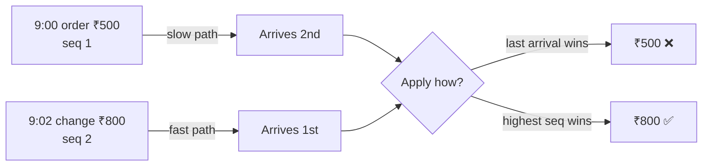

# Day 3 · Out-of-order data

!!! abstract "In one line"
    Messages about the same thing can take different paths and arrive in **any** order. If you apply them as they arrive, an old message can overwrite a newer one, and the wrong value spreads to everything downstream.

<span class="dd-fix">event time</span> <span class="dd-fix">sequence number</span> <span class="dd-fix">latest version wins</span>

## The story: Raju's ₹300 loss

At **9:00** a customer orders a ₹500 thali. At **9:02** he changes it to the ₹800 thali. Two messages.

The network is slow, and they arrive **out of order**: the change comes first, the old order comes last. Raju writes each message as it arrives, so the **old order wipes out the new one**. He bills ₹500 and loses ₹300, without doing anything wrong.

In a shop it's one wrong bill. **In apps**, millions of messages take different paths, so they can arrive in any order, and the wrong value flows into bills, payments and reports. That is **out-of-order data**.

## Why it happens in real systems

| Cause | Example |
|---|---|
| Different network paths | The change goes over Wi-Fi, the original over a slow mobile network |
| Retries | The first send fails and is retried after the second one already got through |
| Parallel consumers | Kafka partitions or Spark tasks process messages for the same order side by side |
| Batch + stream mix | The stream delivers the latest status, then a nightly file re-sends an older one |
| Wrong device clocks | A phone's clock is a few minutes off, so its timestamps lie about the order |

The key question is not "which message arrived last?" but **"which version is newest?"**



## Fix 1: Event time

**Raju:** reads the **time written on each message**, not when it reached him. 9:02 is newer than 9:00.
**The app:** every message carries `event_time`, the moment the change happened, and "latest" is decided by that.

The [sample data](https://github.com/datadukaan/datadukaan.github.io/tree/main/code/day-03-out-of-order-data) has three orders whose correct total is **₹2,250**. Taking the last message received gives ₹1,950; taking the latest event time fixes order 101.

??? example "PySpark: arrival order vs event time (`01_event_time.py`)"
    ```python
    --8<-- "day-03-out-of-order-data/01_event_time.py"
    ```

```text
Latest by ARRIVAL:          Latest by EVENT TIME:
|order_id|amount|          |order_id|amount|
|     101|   500| ❌        |     101|   800| ✅
|     102|   450|           |     102|   300| ❌  <- slow phone clock
|     103|  1000|           |     103|  1000|
total: 1950                 total: 2100
```

But look at order 102. Its phone's clock was slow, so the change is stamped **9:58**, two minutes *before* the 10:00 order it changes. Event time picks the old value. Device clocks can't be fully trusted.

## Fix 2: Sequence number

**Raju:** gives each change a **number**: the order is 1, the change is 2.
**The app:** the source system stamps every update with the next number for that record (a version, revision or log sequence number). A counter can't drift like a clock.

??? example "PySpark: highest seq wins (`02_sequence_number.py`)"
    ```python
    --8<-- "day-03-out-of-order-data/02_sequence_number.py"
    ```

```text
+--------+---+------+------+
|order_id|seq|  type|amount|
+--------+---+------+------+
|     101|  2|change|   800|
|     102|  2|change|   450|
|     103|  1| order|  1000|
+--------+---+------+------+
total: 2250
```

| Ordering key | Pros | Cons |
|---|---|---|
| Arrival / processing time | Always available | Says nothing about which change is newer |
| Event time | Meaningful to the business; needed for daily totals ([Day 1](day-01-late-arriving-data.md)) | Device clocks drift; two events can share a timestamp |
| Sequence / version number | Exact order of changes to one record | Must be assigned by the source, per record |
| Database log position (CDC LSN / offset) | Free and exact when reading a database's change log | Only exists for CDC sources (coming on Day 5) |

!!! tip "In practice"
    Use the sequence number to decide **which version wins**, and event time for **when it happened** (reporting, windows). Kafka keeps order only *within one partition*, so key messages by `order_id` to keep one order's changes together.

## Fix 3: Latest version wins

**Raju:** if message 1 arrives after message 2, he **ignores** it. He only writes a bigger number.
**The app:** updates the row **only if the incoming version is newer**. An old message can never overwrite a new one.

=== "Delta Lake / Databricks SQL"
    ```sql
    --8<-- "day-03-out-of-order-data/03_latest_version_wins_delta.sql"
    ```

=== "Runnable demo (DuckDB)"
    ```python
    --8<-- "day-03-out-of-order-data/03_latest_version_wins.py"
    ```

=== "dbt incremental model"
    ```sql
    --8<-- "day-03-out-of-order-data/dbt_project/models/orders_current.sql"
    ```

Messages applied one by one in the order they arrived:

```text
m01: order 101 seq 2 Rs   800  ->  plain upsert   800  |  latest-version-wins   800
m02: order 101 seq 1 Rs   500  ->  plain upsert   500  |  latest-version-wins   800
m03: order 102 seq 1 Rs   300  ->  plain upsert   300  |  latest-version-wins   300
m04: order 102 seq 2 Rs   450  ->  plain upsert   450  |  latest-version-wins   450
m05: order 103 seq 1 Rs  1000  ->  plain upsert  1000  |  latest-version-wins  1000
plain total: 1950
guarded total: 2250
```

The dbt demo (`./dbt_project/run_demo.sh`) runs twice: at 09:02:45 only the change has arrived (101 = ₹800); at the end of the day the old seq 1 arrives too, and 101 **stays ₹800**.

!!! warning "Why the guard matters"
    A plain upsert or MERGE is idempotent ([Day 2](day-02-duplicate-data.md)) but not order-safe: rerun the same messages in a different order and you get a different answer. The `seq > current seq` condition makes the result the same in **any** order.

## When to use what

| Situation | Approach |
|---|---|
| Current state of a record (order, account, profile) | Sequence number + guarded upsert (Fix 2 + 3) |
| Daily or windowed totals | Event time + watermark + reprocessing ([Day 1](day-01-late-arriving-data.md)) |
| Database replication (CDC) | Use the log position (LSN / offset) as the sequence |
| Kafka consumers | Partition by the record key so its changes stay in order, and still guard on seq |
| No version from the source | Event time as a best effort, plus an ingestion counter to break ties |

## Interview questions

??? question "Kafka guarantees ordering. Why can events still arrive out of order?"
    Only within a single partition. Messages for the same key can land in different partitions if the key isn't used for partitioning, producers can retry and reorder without idempotent settings, and anything outside Kafka (a batch file, a second source) has no ordering guarantee at all.

??? question "Why is event time not enough to pick the latest version of a record?"
    It comes from device or server clocks that drift and can collide. A per-record sequence or version number assigned by the source is exact.

??? question "How do you make an upsert safe against out-of-order updates?"
    Add a condition so it only updates when the incoming version is newer: `MERGE ... WHEN MATCHED AND s.seq > t.seq THEN UPDATE`, and dedupe the batch to its highest version per key first.

??? question "What's the difference between idempotent and order-independent writes?"
    Idempotent: applying the same message twice gives the same result. Order-independent: applying messages in any order gives the same result. A plain MERGE is the first, a version-guarded MERGE is both.

## Run it yourself

```bash
git clone https://github.com/datadukaan/datadukaan.github.io.git
cd datadukaan.github.io && pip install -r requirements.txt
cd code/day-03-out-of-order-data
python 01_event_time.py            # Fix 1  (needs Java 17+ for PySpark)
python 02_sequence_number.py       # Fix 2
python 03_latest_version_wins.py   # Fix 3
./dbt_project/run_demo.sh          # Fix 3 in dbt
```

## Further reading

- [Apache Kafka: design, ordering and partitions](https://kafka.apache.org/documentation/#design)
- [Delta Lake: upsert into a table using MERGE](https://docs.delta.io/latest/delta-update.html#upsert-into-a-table-using-merge)
- [Spark Structured Streaming: event time and late data](https://spark.apache.org/docs/latest/streaming/apis-on-dataframes-and-datasets.html#handling-late-data-and-watermarking)
- [dbt: incremental models](https://docs.getdbt.com/docs/build/incremental-models)

---

*Watch the short version on [Instagram](https://instagram.com/datadukaan) or [YouTube](https://youtube.com/@datadukaan). Previous: [Day 2](day-02-duplicate-data.md). Next: [Day 4 · Incremental loads](day-04-incremental-loads.md).*
