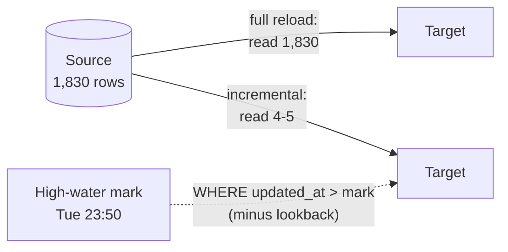

# Day 4 · Incremental loads

!!! abstract "In one line"
    Reloading the whole table every night gets slower and costlier every day the business exists. Load only what changed since last time, using a saved **high-water mark**, and look back a little in case some changes arrived late.

<span class="dd-fix">high-water mark</span> <span class="dd-fix">incremental load</span> <span class="dd-fix">lookback window</span>

## The story: Raju opens late

Raju's shop opened **late**. Customers waited, and some went to the next shop. Raju was still **counting**.

Every night he adds up his sales, but he starts from **page one**: the day he opened the shop, five years ago. Thousands of pages, just to add **one** new day. Every year the notebook gets thicker and the counting takes longer.

In a shop it's one tired shopkeeper. **In apps**, jobs reload millions of old rows every night. They take hours, cost money, and the morning reports come in late. That is a **full reload**.

## Why it happens in real systems

| Cause | Example |
|---|---|
| It was the easiest first version | `SELECT *` into the warehouse, overwrite, done; fine at 10,000 rows, painful at 10 billion |
| No reliable change column | The source table has no `updated_at`, so there's no way to ask "what changed?" |
| Fear of missing changes | Updates and late commits slip past a naive filter, so teams reload "to be safe" |
| Tools default to it | Many copy activities and connectors do a full copy unless you configure otherwise |

A full reload's cost grows with the **size of the table**. An incremental load's cost grows with the **size of the change**.



## The sample data

[Two snapshots](https://github.com/datadukaan/datadukaan.github.io/tree/main/code/day-04-incremental-loads) of a source `orders` table, one order a day for five years: Tuesday night (1,826 rows) and Wednesday night (1,830 rows). By Wednesday three new orders arrived, Tuesday's bill 1826 was **fixed** (+₹500), and order 1827 appeared: stamped Tuesday 23:40, but committed after Tuesday's load had already run.

A full reload reads all **1,830** rows to get the right answer: **1,830 orders, ₹28,65,930**.

??? example "PySpark: full reload (`01_full_reload.py`)"
    ```python
    --8<-- "day-04-incremental-loads/01_full_reload.py"
    ```

## Fix 1: High-water mark

**Raju:** puts a **bookmark** on the last page he counted.
**The app:** after each load, saves the latest `updated_at` it loaded, the **high-water mark**, in a small state table (or reads it back from the target: `max(updated_at)`).

Use a column that changes on **every insert and update** (`updated_at`, a row version, a CDC log position). `created_at` misses edits: Tuesday's fixed bill 1826 would never be reloaded.

## Fix 2: Incremental load

**Raju:** tonight he opens the bookmark and reads only the **new** pages.
**The app:** reads only rows with `updated_at > mark` and upserts them into the target.

??? example "PySpark: high-water mark + incremental load (`02_incremental_load.py`)"
    ```python
    --8<-- "day-04-incremental-loads/02_incremental_load.py"
    ```

```text
Tuesday night: loaded 1826 rows; high-water mark = 2026-11-03 23:50:00
Wednesday night: rows read from source = 4
|order_id|amount|         created_at|         updated_at|
|    1826|  3110|2026-11-03 23:50:00|2026-11-04 10:15:00|   <- fixed bill, caught via updated_at
|    1828|   800|2026-11-04 11:05:00|2026-11-04 11:05:00|
|    1829|  1500|2026-11-04 14:05:00|2026-11-04 14:05:00|
|    1830|  2200|2026-11-04 19:05:00|2026-11-04 19:05:00|
orders: 1829   total: 2864730
Orders in source but missing from target:
|    1827|  1200|2026-11-03 23:40:00|2026-11-03 23:40:00|
```

4 rows read instead of 1,830, but **one order is missing**. Order 1827's timestamp (23:40) is *behind* the bookmark (23:50), because its transaction committed after Tuesday's load ran. A strict `> mark` filter will never see it.

## Fix 3: Lookback window

**Raju:** always re-reads the **last page** too, in case a bill was added or fixed late.
**The app:** reads from a little **before** the mark (`updated_at > mark - 1 hour`). Rows it already loaded come back again, so the write must be an **upsert**, Day 2's [idempotent write](day-02-duplicate-data.md); re-loading them changes nothing.

=== "Delta Lake / Databricks SQL"
    ```sql
    --8<-- "day-04-incremental-loads/03_lookback_window_delta.sql"
    ```

=== "Runnable demo (DuckDB)"
    ```python
    --8<-- "day-04-incremental-loads/03_lookback_window.py"
    ```

=== "dbt incremental model"
    ```sql
    --8<-- "day-04-incremental-loads/dbt_project/models/orders.sql"
    ```

```text
Tuesday night: high-water mark = 2026-11-03 23:50:00
Wednesday night: rows read from source = 5 (lookback 1 hour)
incremental + lookback: 1830 orders, total 2,865,930
full reload:            1830 orders, total 2,865,930
match: True
```

The dbt demo (`./dbt_project/run_demo.sh`) gives the same: 1,826 orders on Tuesday's full build, then **1,830 orders, 28,65,930** after Wednesday's incremental run.

| Lookback | Pros | Cons |
|---|---|---|
| None | Reads the least | Misses late commits and clock lag |
| Small (minutes to hours) | Catches most late commits cheaply | Re-reads a few rows every run |
| Large (days) | Also catches very late corrections | Reads more; approaches a full reload |

Size it from data: measure how far behind the bookmark late rows land (commit time minus `updated_at`) and cover that.

!!! warning "Two rules that keep incremental loads honest"
    1. **Move the bookmark only after the write succeeds.** If the job fails halfway, the next run starts from the old mark and redoes the work instead of skipping it.
    2. **Deletes are invisible.** A deleted row has no `updated_at` to find. Use soft deletes or CDC ([Days 5](day-05-change-data-capture.md) and [6](day-06-soft-deletes.md)), or run a periodic full reconciliation.

## When to use what

| Situation | Approach |
|---|---|
| Small reference tables (countries, products) | Full reload is fine and simpler |
| Large append-only data (events, logs) | Incremental on an ingestion timestamp or file arrival |
| Large tables with updates | Incremental on `updated_at` + lookback + upsert (Fix 1 + 2 + 3) |
| Source has a change log | [Change Data Capture](day-05-change-data-capture.md) (Day 5) |
| No change column at all | Full reload, or hash-compare rows to find changes |

## Interview questions

??? question "What is a high-water mark and where do you store it?"
    The highest value of a change-tracking column (usually `updated_at`) already loaded. Store it in a small state/control table, in the orchestrator, or derive it from the target with `max(updated_at)`. Update it only after the load commits.

??? question "Why use updated_at instead of created_at for incremental loads?"
    `created_at` never changes, so updates to existing rows are never picked up. `updated_at` (or a row version) changes on every insert and update.

??? question "How can an incremental load miss rows, and how do you prevent it?"
    Rows committed after the previous load but stamped earlier than the mark (long transactions, clock lag), and hard deletes. Use a lookback window with an idempotent upsert for the first, and soft deletes, CDC or periodic reconciliation for the second.

??? question "How does a dbt incremental model work?"
    On the first run (or `--full-refresh`) it builds the whole table. On later runs `is_incremental()` is true, so the model filters to new rows (typically `updated_at > (select max(updated_at) from {{ this }})`), and dbt merges them using `unique_key`.

## Run it yourself

```bash
git clone https://github.com/datadukaan/datadukaan.github.io.git
cd datadukaan.github.io && pip install -r requirements.txt
cd code/day-04-incremental-loads
python 01_full_reload.py        # the problem (needs Java 17+ for PySpark)
python 02_incremental_load.py   # Fix 1 + 2
python 03_lookback_window.py    # Fix 3
./dbt_project/run_demo.sh       # all three in dbt
```

## Further reading

- [dbt: configuring incremental models](https://docs.getdbt.com/docs/build/incremental-models)
- [Azure Data Factory: incrementally load data using a watermark](https://learn.microsoft.com/en-us/azure/data-factory/tutorial-incremental-copy-overview)
- [Delta Lake: upsert into a table using MERGE](https://docs.delta.io/latest/delta-update.html#upsert-into-a-table-using-merge)
- [Snowflake: streams for change tracking](https://docs.snowflake.com/en/user-guide/streams-intro)

---

*Watch the short version on [Instagram](https://instagram.com/datadukaan) or [YouTube](https://youtube.com/@datadukaan). Previous: [Day 3](day-03-out-of-order-data.md). Next: [Day 5 · Change Data Capture](day-05-change-data-capture.md).*
