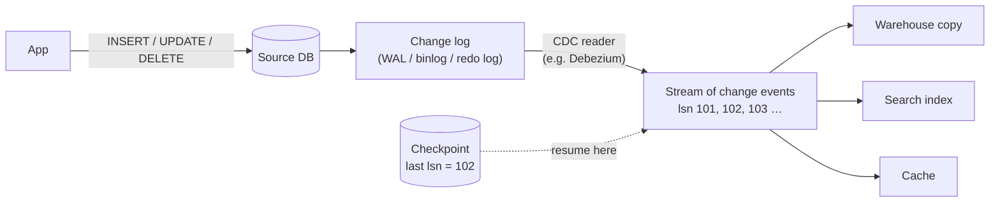

# Day 5 · Change Data Capture

!!! abstract "In one line"
    A copy refreshed by a nightly full copy is wrong all day and costly to refresh. Every database already writes each change to a log; read that log and send only the changes to the copy, and remember where you stopped.

<span class="dd-fix">change log</span> <span class="dd-fix">Change Data Capture</span> <span class="dd-fix">checkpoint</span>

## The story: Raju's ₹1,200 price

Raju raised the thali price from **₹120 to ₹150**. But his son's counter still charged ₹120. Forty plates later, they had lost **₹1,200**.

Raju keeps the **master** price list; his son keeps a **copy** at the second counter. Every night the son copies Raju's **whole** notebook: hundreds of lines, to catch one change. And in between, his copy is wrong.

In a shop it's one stale price list. **In apps**, dashboards, search and reports all keep copies of the app's database. Copying everything is slow, and the copies are always behind. That is the **sync problem**.

## Why it happens in real systems

| Copy of the app database | What goes wrong when it's stale |
|---|---|
| Analytics warehouse / lakehouse | Dashboards and finance reports show yesterday's numbers |
| Search index | Customers find items that are sold out or deleted |
| Cache | The app shows an old price or address |
| Other microservices | Billing charges the old plan; shipping uses the old address |
| ML feature store | Models score on out-of-date features |

Full copies and [Day 4's incremental loads](day-04-incremental-loads.md) both *query* the source table. Querying adds load to the production database, runs on a schedule, and can't see **deletes**. CDC reads the database's own log instead.



## The problem in numbers

The [sample data](https://github.com/datadukaan/datadukaan.github.io/tree/main/code/day-05-change-data-capture) is a 4-item menu. The copy was refreshed at midnight; by noon the master has changed 4 times.

??? example "PySpark: the stale nightly copy (`01_nightly_full_copy.py`)"
    ```python
    --8<-- "day-05-change-data-capture/01_nightly_full_copy.py"
    ```

```text
At noon, rows where the copy disagrees with the source:
|item_id| item|source_price|copy_price|
|      1|  Tea|          18|        15|
|      2|Thali|         150|       120|
|      4| Vada|        NULL|        25|   <- deleted at the source, still in the copy
|      5|Lassi|          40|      NULL|   <- new at the source, missing from the copy
40 thalis sold at the copy's price: lost Rs 1,200
```

## Fix 1: Change log

**Raju:** writes every change in a small **diary**: "thali, 120 → 150."
**The database:** already does. Every insert, update and delete is written to its log *before* the table changes, for crash recovery and replication: PostgreSQL's **WAL**, MySQL's **binlog**, SQL Server's **transaction log**, Oracle's **redo log**. Each entry has a position (LSN / offset) that only goes up.

```text
|lsn| op|item_id| item|price|         changed_at|
|101|  u|      2|Thali|  150|2026-11-05 09:00:00|   u = update
|102|  c|      5|Lassi|   40|2026-11-05 09:30:00|   c = create (insert)
|103|  d|      4| Vada| NULL|2026-11-05 10:15:00|   d = delete
|104|  u|      1|  Tea|   18|2026-11-05 11:00:00|
```

## Fix 2: Change Data Capture

**Raju's son:** reads only the **diary**, not the whole notebook. Within minutes, his copy matches.
**The app:** a CDC tool reads the log and streams one event per change to every copy, which applies them in log order: insert and update become an upsert, delete removes the row.

??? example "PySpark: apply the change log (`02_apply_change_log.py`)"
    ```python
    --8<-- "day-05-change-data-capture/02_apply_change_log.py"
    ```

```text
Copy after applying the log:
|item_id| item|price|
|      1|  Tea|   18|
|      2|Thali|  150|
|      3| Dosa|   60|
|      5|Lassi|   40|
copy == source: True
```

4 events read instead of the whole table, and the **delete** came through, which no `updated_at` filter can do.

| Way to keep a copy | Freshness | Load on source | Sees deletes | Effort |
|---|---|---|---|---|
| Nightly full copy | Up to a day behind | Heavy, every run | Yes (rebuilds everything) | Lowest |
| Incremental on `updated_at` ([Day 4](day-04-incremental-loads.md)) | Minutes to hours | Query per run | **No** | Low |
| Log-based CDC | Seconds | Light (reads the log) | Yes | Highest: log access, a CDC tool, schema changes |

## Fix 3: Checkpoint

**Raju's son:** marks the **last line** he read. After a break, he starts right there.
**The app:** the CDC consumer saves the last log position it applied, its **checkpoint** (Kafka consumer offset, Spark `checkpointLocation`, a state table). After a crash or deploy it resumes from there.

=== "Delta Lake / Databricks SQL"
    ```sql
    --8<-- "day-05-change-data-capture/03_apply_changes_delta.sql"
    ```

=== "Runnable demo (DuckDB)"
    ```python
    --8<-- "day-05-change-data-capture/03_checkpoint.py"
    ```

=== "dbt model"
    ```sql
    --8<-- "day-05-change-data-capture/dbt_project/models/menu_copy.sql"
    ```

The consumer crashes after event 102, then restarts three ways:

```text
restart from the checkpoint    checkpoint was 102  ->  Tea 18, Thali 150, Dosa 60, Lassi 40          matches source: True
restart from the latest event  checkpoint was 102  ->  Tea 18, Thali 150, Dosa 60, Vada 25, Lassi 40 matches source: False
restart from the beginning     checkpoint was 102  ->  Tea 18, Thali 150, Dosa 60, Lassi 40          matches source: True
```

Skip ahead and the delete of Vada is lost forever. Starting over works only because every apply is an upsert or delete by key, Day 2's [idempotent write](day-02-duplicate-data.md); with plain inserts it would duplicate rows.

!!! warning "Save the checkpoint after the write, not before"
    Write first, then move the checkpoint. A crash in between replays a few events (harmless with idempotent writes) instead of skipping them (silent data loss). This is "at-least-once + idempotent = effectively exactly once".

## When to use what

| Situation | Approach |
|---|---|
| Small tables, daily reports | Nightly full copy is fine |
| Large tables, hourly freshness, no deletes | Incremental on `updated_at` ([Day 4](day-04-incremental-loads.md)) |
| Copies that must be current: search, cache, microservices | Log-based CDC + checkpoint |
| Lakehouse ingestion of an OLTP database | CDC into bronze, MERGE into silver (Databricks `APPLY CHANGES`, Snowflake streams, ADF CDC) |
| Hard deletes matter (finance, GDPR) | CDC, so `d` events reach every copy (more on Day 6) |

## Interview questions

??? question "What is Change Data Capture and how is log-based CDC different from query-based?"
    CDC captures row-level inserts, updates and deletes from a source so other systems can apply them. Query-based CDC polls the table with a filter like `updated_at > mark`; it adds load and misses hard deletes. Log-based CDC reads the database's transaction log (WAL, binlog, redo log), so it sees every change, including deletes, in order and with little load on the source.

??? question "How do you apply CDC events to a target table correctly?"
    Keep the latest event per key by log position (LSN), then MERGE: delete when the op is `d`, update when matched, insert when not. Dedupe the batch first, and guard against older events overwriting newer ones ([Day 3](day-03-out-of-order-data.md)).

??? question "What happens if a CDC consumer crashes?"
    It restarts from its last committed checkpoint (offset/LSN). Events after it are replayed, so applies must be idempotent. If the checkpoint is committed before the write, events can be skipped; commit after the write.

??? question "Name some CDC tools."
    Debezium (with Kafka Connect), Azure Data Factory / Fabric CDC, AWS DMS, Fivetran, Striim; Snowflake streams and Delta Lake Change Data Feed for changes *within* a warehouse or lakehouse.

## Run it yourself

```bash
git clone https://github.com/datadukaan/datadukaan.github.io.git
cd datadukaan.github.io && pip install -r requirements.txt
cd code/day-05-change-data-capture
python 01_nightly_full_copy.py   # the problem (needs Java 17+ for PySpark)
python 02_apply_change_log.py    # Fix 1 + 2
python 03_checkpoint.py          # Fix 3
./dbt_project/run_demo.sh        # rebuild the copy in dbt
```

## Further reading

- [Debezium: features and architecture](https://debezium.io/documentation/reference/stable/features.html)
- [PostgreSQL: Write-Ahead Logging and logical decoding](https://www.postgresql.org/docs/current/logicaldecoding-explanation.html)
- [Delta Lake: Change Data Feed](https://docs.delta.io/latest/delta-change-data-feed.html)
- [Snowflake: introduction to streams](https://docs.snowflake.com/en/user-guide/streams-intro)
- [Azure Data Factory: change data capture](https://learn.microsoft.com/en-us/azure/data-factory/concepts-change-data-capture)

---

*Watch the short version on [Instagram](https://instagram.com/datadukaan) or [YouTube](https://youtube.com/@datadukaan). Previous: [Day 4](day-04-incremental-loads.md). Next: Day 6.*
