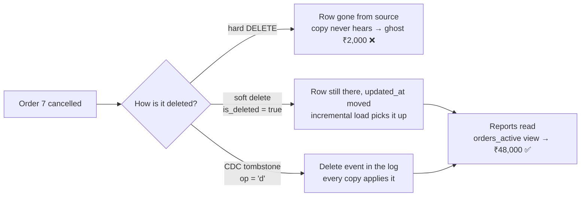

# Day 6 · Soft deletes & tombstones

!!! abstract "In one line"
    When a row is deleted from the source, every copy that doesn't hear about it keeps a **ghost record**, and reports keep counting it. Mark rows deleted instead of erasing them, send a delete event to every copy, and point reports at active rows only.

<span class="dd-fix">soft delete</span> <span class="dd-fix">tombstone</span> <span class="dd-fix">filtered view</span>

## The story: Raju pays tax on a cancelled order

A customer **cancelled** a ₹2,000 order. But at month-end, Raju's report still counted it, and he paid tax on money he never got.

When the order was cancelled, Raju **tore the page out**. Gone, clean notebook. But his son's copy ([Day 5](day-05-change-data-capture.md)) never heard about it: there was no page left to say "cancelled." So the copy kept the order, and the report added it up.

In a shop it's one torn page. **In apps**, one delete in the database leaves copies everywhere (dashboards, reports, other apps), and nothing tells them it's gone. That is a **ghost record**.

## Why it happens in real systems

| Cause | Example |
|---|---|
| Hard `DELETE` + query-based loads | `WHERE updated_at > mark` ([Day 4](day-04-incremental-loads.md)) can only find rows that still exist |
| Append-only copies | The lake keeps every row it ever received; deletes never arrive |
| Partial CDC setups | The pipeline handles inserts and updates but ignores `op = 'd'` events |
| Cancellations as new rows | A refund is a separate record, but reports sum the original order anyway |
| Privacy deletes | A customer's "delete my data" request is applied to the app, not to its copies |



## The problem in numbers

The [sample data](https://github.com/datadukaan/datadukaan.github.io/tree/main/code/day-06-soft-deletes) has 10 November orders worth **₹50,000**. Order 7 (₹2,000) is cancelled and hard-deleted from the source.

??? example "PySpark: an incremental load can't see a hard delete (`01_hard_delete.py`)"
    ```python
    --8<-- "day-06-soft-deletes/01_hard_delete.py"
    ```

```text
Night 2: rows changed since the mark = 0
Source total (truth):  48000
Copy total (report):   50000
Ghost rows in the copy:
|order_id|amount|         created_at|         updated_at|
|       7|  2000|2026-11-02 16:00:00|2026-11-02 16:00:00|
```

## Fix 1: Soft delete

**Raju:** stops tearing pages. He writes **"CANCELLED"** on the order instead.
**The app:** never runs `DELETE` on business records. It sets `is_deleted = true` (or `deleted_at = now()`) and moves `updated_at`. The row stays, so every incremental load, audit and undo still sees it.

??? example "PySpark: the soft delete reaches the copy (`02_soft_delete.py`)"
    ```python
    --8<-- "day-06-soft-deletes/02_soft_delete.py"
    ```

```text
Night 2: rows changed since the mark = 1
|order_id|amount|         created_at|         updated_at|is_deleted|
|       7|  2000|2026-11-02 16:00:00|2026-11-06 09:00:00|      true|
But a report that sums every row is still wrong:
total: 50000
```

The copy now **knows** about the cancellation, but the row is still there, so a plain `SUM(amount)` still says ₹50,000. That's why Fix 3 exists.

## Fix 2: Tombstone

**Raju:** writes in the diary, "order 7 **removed**." His son crosses it out too.
**The app:** when a row is hard-deleted, log-based CDC still sees the delete in the database log and emits a delete event: the key, `op = 'd'`, no values. That event is a **tombstone**. In Kafka it's literally a message with the key and a `null` value; log compaction keeps it long enough for every consumer to see it, then removes it.

??? example "DuckDB: apply the tombstone (`03_tombstone.py`)"
    ```python
    --8<-- "day-06-soft-deletes/03_tombstone.py"
    ```

```text
CDC events: [(201, 'd', 7)]
[(7, 2000, True)]        <- order 7 flagged deleted in the copy
```

| Delete strategy | Copies find out? | History / undo | Storage | Privacy erasure |
|---|---|---|---|---|
| Hard delete, query-based load | **No**: ghosts | Lost | Smallest | Source only |
| Soft delete flag | Yes, via `updated_at` | Kept | Grows; purge later | Needs a later purge |
| Hard delete + CDC tombstone | Yes, via the log | Lost in source, copies choose | Small | Reaches every copy |

## Fix 3: Filtered view

**Raju:** every report now **skips** the cancelled lines.
**The app:** publishes a view with the filter built in, and points every dashboard and report at it, so no analyst has to remember `WHERE NOT is_deleted`.

=== "Delta Lake / Databricks SQL"
    ```sql
    --8<-- "day-06-soft-deletes/delete_patterns_delta.sql"
    ```

=== "Runnable demo (DuckDB)"
    ```python
    --8<-- "day-06-soft-deletes/04_filtered_view.py"
    ```

=== "dbt models"
    ```sql
    --8<-- "day-06-soft-deletes/dbt_project/models/orders.sql"
    ```
    ```sql
    --8<-- "day-06-soft-deletes/dbt_project/models/orders_active.sql"
    ```

```text
report from orders         10 orders, total Rs 50,000
report from orders_active   9 orders, total Rs 48,000
```

The dbt demo (`./dbt_project/run_demo.sh`) gives the same: after night 2 the `orders` table still has 10 rows (₹50,000) for audit, while `orders_active` has 9 (₹48,000).

!!! warning "Soft-deleted is not erased"
    For privacy laws (GDPR, India's DPDP Act) a flag is not enough: the data must actually be removed, from the source **and** every copy. Purge soft-deleted rows after a retention period, make sure tombstones reach every copy, and on Delta Lake run `VACUUM` so old file versions holding the data are cleaned up too. More on Day 84.

## When to use what

| Situation | Approach |
|---|---|
| Business records (orders, payments, accounts) | Soft delete + filtered view (Fix 1 + 3) |
| Source you don't control that hard-deletes | Log-based CDC with tombstones (Fix 2), or a periodic full compare of keys |
| Kafka topics keyed by ID | Tombstones + log compaction |
| Personal data and erasure requests | Hard delete or purge everywhere, propagated by tombstones; then `VACUUM` |
| Fact tables in a warehouse | Keep the flag in the table, expose `*_active` views to BI |

## Interview questions

??? question "What's the difference between a soft delete and a hard delete?"
    A hard delete removes the row. A soft delete marks it (`is_deleted`, `deleted_at`) and keeps it. Soft deletes keep history, allow undo and are visible to incremental loads; hard deletes save space and actually erase data.

??? question "Why can't an incremental load on updated_at detect deletes, and how do you fix it?"
    It only finds rows that still exist with a newer timestamp; a deleted row is simply absent. Fix it with soft deletes (the delete becomes an update), log-based CDC (delete events), or a periodic comparison of source and target keys.

??? question "What is a tombstone in Kafka or CDC?"
    A delete event: the key with a null value (Kafka) or `op = 'd'` (Debezium). Consumers apply it by deleting or flagging the row; log compaction keeps it for `delete.retention.ms`, then drops it along with older values for that key.

??? question "How do you stop soft-deleted rows from leaking into reports?"
    Don't rely on every query adding the filter. Publish a view or semantic-layer model of active rows only and point BI tools at it; keep the full table for audit.

## Run it yourself

```bash
git clone https://github.com/datadukaan/datadukaan.github.io.git
cd datadukaan.github.io && pip install -r requirements.txt
cd code/day-06-soft-deletes
python 01_hard_delete.py     # the problem (needs Java 17+ for PySpark)
python 02_soft_delete.py     # Fix 1
python 03_tombstone.py       # Fix 2
python 04_filtered_view.py   # Fix 3
./dbt_project/run_demo.sh    # Fix 1 + 3 in dbt
```

## Further reading

- [Debezium: delete events and tombstones](https://debezium.io/documentation/reference/stable/connectors/postgresql.html#postgresql-delete-events)
- [Apache Kafka: log compaction](https://kafka.apache.org/documentation/#compaction)
- [Delta Lake: delete from a table and VACUUM](https://docs.delta.io/latest/delta-update.html#delete-from-a-table)
- [dbt: incremental models](https://docs.getdbt.com/docs/build/incremental-models)

---

*Watch the short version on [Instagram](https://instagram.com/datadukaan) or [YouTube](https://youtube.com/@datadukaan). Previous: [Day 5](day-05-change-data-capture.md). Next: [Day 7 · Rate limits & backoff](day-07-rate-limits.md).*
