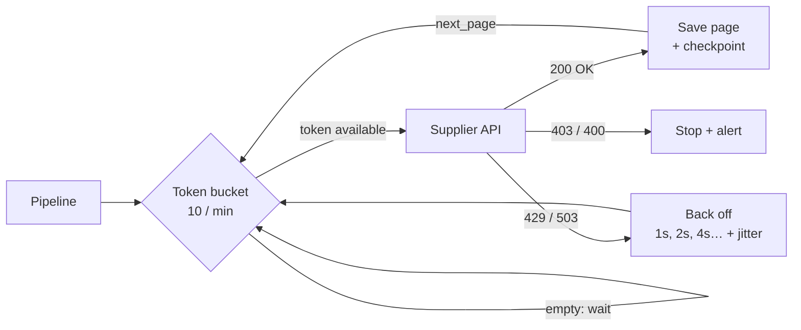

# Day 7 · Rate limits & backoff

!!! abstract "In one line"
    Other companies' APIs only answer so many requests a minute. Blast them and retry instantly, and you get blocked. Pace yourself, wait longer after each refusal, and fetch in pages you can resume from.

<span class="dd-fix">rate limit</span> <span class="dd-fix">exponential backoff</span> <span class="dd-fix">pagination + checkpoint</span>

## The story: Raju loses a ₹50,000 wedding order

A **₹50,000** wedding order. Raju had to quote prices by **10 a.m.** He missed it, and the order went to the shop next door.

Raju had sent his son to the supplier with a list of **500 items**. One counter, one clerk, a long queue. The son was in a hurry and read out all 500, non-stop. The clerk said, "Slowly, bhaiya!" The son read it all again, louder. *Dhadaam.* The shutter came down: "Come back tomorrow."

In a shop it's one angry clerk. **In apps**, pipelines hit other companies' systems thousands of times a minute. Too fast, and the door slams shut: no data, empty reports. That is **getting rate limited**.

## Why it happens in real systems

| Cause | Example |
|---|---|
| One request per record | Calling `/price/{id}` 500 times instead of `/prices?page=1` 5 times |
| Too much parallelism | 200 Spark tasks each calling the API at once |
| Instant retries | A loop that retries a 429 immediately, turning one refusal into hundreds |
| Retry storms | Every client retries at the same second after an outage |
| Shared quota | Your nightly job and another team's dashboard use the same API key |

APIs answer **429 Too Many Requests** (often with a `Retry-After` header) when you're over the limit. Many escalate: keep hammering and you get **403** or a temporary ban.



## The problem in numbers

The [code](https://github.com/datadukaan/datadukaan.github.io/tree/main/code/day-07-rate-limits) uses a small **simulated supplier API** with a fake clock, so it runs in seconds and gives the same result every time. It allows **10 requests per minute**, answers 429 above that, and bans a client for 24 hours after 20 strikes. `data/items.csv` has the 500 items.

??? example "The simulated API (`supplier_api.py`)"
    ```python
    --8<-- "day-07-rate-limits/supplier_api.py"
    ```

??? example "The son's approach: burst + instant retries (`01_no_limit.py`)"
    ```python
    --8<-- "day-07-rate-limits/01_no_limit.py"
    ```

```text
requests sent: 1480
responses: {200: 10, 403: 1450, 429: 20}   (429 = too many, 403 = banned)
prices received: 10 of 500
banned until: +24.0 hours
```

10 prices out of 500, a **24-hour ban**, and 1,450 wasted requests made after the shutter was already down.

## Fix 1: Rate limit

**Raju:** asks at a **steady pace**: ten items a minute.
**The app:** never sends more requests than the API allows. A **token bucket** refills at the allowed rate; each request spends a token, and the client waits when the bucket is empty.

??? example "Token bucket at 10 / minute (`02_rate_limit.py`)"
    ```python
    --8<-- "day-07-rate-limits/02_rate_limit.py"
    ```

```text
requests sent: 50
responses: {200: 50}
prices received: 50 of 50 in 4.9 minutes
=> 500 items one by one would take 50 minutes. Fix 3 fixes that.
```

Zero refusals. A bucket that allows a **burst** of 10 still got 429s here (the API counts a sliding 60-second window), so match the API's rule, not just its average.

## Fix 2: Exponential backoff

**Raju:** if the clerk says "wait", **don't shout again**. Wait one minute, then two, then four.
**The app:** after a 429 or 503, waits `base × 2^attempt` (capped), honours `Retry-After`, and adds a little random **jitter** so many clients don't all retry at the same instant. After a few tries it gives up and alerts.

??? example "Backoff with jitter on 429 and 503 (`03_backoff.py`)"
    ```python
    --8<-- "day-07-rate-limits/03_backoff.py"
    ```

```text
prices received: 30 of 30, requests sent: 47, banned: False
first waits (status, seconds): [(503, 1.1), (503, 0.8), (429, 52.9), (429, 4.7), (429, 4.4), (503, 1.1)]
total time: 3.2 minutes
```

The API here also fails every 4th call with **503** (a hiccup). Backoff rides through both kinds of refusal and is never banned.

| Retry strategy | Behaviour under 429s | Risk |
|---|---|---|
| Retry immediately | Hammers the API, escalates to a ban | Very high |
| Fixed wait (e.g. 5 s) | OK for one client | Many clients retry in sync |
| Exponential backoff | Backs off fast, recovers fast | Slow if the cap is too high |
| Exponential + jitter + Retry-After | Spreads retries, follows the API's hint | The standard choice |

!!! warning "Not every error deserves a retry"
    Retry **429** (slow down) and **5xx** (server hiccup). Don't retry **400** (bad request), **401/403** (auth or banned) or **404**: they won't fix themselves, so stop and alert. Make the call idempotent ([Day 2](day-02-duplicate-data.md)) so a retried write can't double-book.

## Fix 3: Pagination with a checkpoint

**Raju:** asks **one page** at a time and ticks the last page he got. If the shutter comes down, he starts from that page tomorrow, not from item one.
**The app:** fetches 100 items per request (`?page=N&size=100` or a `next` cursor) and saves the last finished page, the same **checkpoint** idea as [Day 5](day-05-change-data-capture.md).

??? example "Pages + checkpoint, crash after page 3 (`04_pagination_checkpoint.py`)"
    ```python
    --8<-- "day-07-rate-limits/04_pagination_checkpoint.py"
    ```

```text
Run 1:
  starting at page 1
  page 1: 100 items  -> checkpoint = 1
  page 2: 100 items  -> checkpoint = 2
  page 3: 100 items  -> checkpoint = 3
  *** shutter comes down (job crashes) ***
Run 2 (next day):
  starting at page 4
  page 4: 100 items  -> checkpoint = 4
  page 5: 100 items  -> checkpoint = 5
items fetched: 500 of 500 with 5 requests (one-by-one would be 500)
```

**500 items in 5 requests** instead of 500, well inside the limit, and the second run picked up at page 4. Save each page to storage *before* moving the checkpoint, so a crash replays a page instead of skipping one.

## Where this lives in your tools

```python
--8<-- "day-07-rate-limits/airflow_and_spark_notes.py"
```

## When to use what

| Situation | Approach |
|---|---|
| Any third-party or internal API | Read its documented limits; token bucket at or below them |
| Big backfills from an API | Pagination + checkpoint; run off-peak; ask for a bulk export if one exists |
| Spark or many parallel workers | Cap concurrency (few partitions, an Airflow pool), one shared limiter |
| Flaky APIs (5xx, timeouts) | Exponential backoff + jitter, a max number of tries, then alert |
| Cursor-based APIs | Checkpoint the cursor, not the page number; cursors survive inserts |

## Interview questions

??? question "What does HTTP 429 mean and how should a pipeline react?"
    Too Many Requests: you're over the rate limit. Slow down: honour `Retry-After` if present, otherwise back off exponentially with jitter, and lower your request rate. Don't retry instantly.

??? question "What is exponential backoff and why add jitter?"
    Waiting longer after each failure (1, 2, 4, 8 s… up to a cap). Jitter randomises each wait so many clients that failed together don't all retry together and cause another spike (a "thundering herd").

??? question "How does a token bucket work?"
    Tokens refill at a fixed rate up to a capacity; each request takes one; when empty, the caller waits. Capacity controls the allowed burst, the refill rate controls the average.

??? question "Offset pagination vs cursor pagination?"
    Offset (`page=4&size=100`) is simple but can skip or repeat rows if data changes between pages. A cursor (`next=abc123`) points at a position in a stable order, so it's safe under inserts and is the better checkpoint.

## Run it yourself

```bash
git clone https://github.com/datadukaan/datadukaan.github.io.git
cd datadukaan.github.io/code/day-07-rate-limits
python 01_no_limit.py                # the problem
python 02_rate_limit.py              # Fix 1
python 03_backoff.py                 # Fix 2
python 04_pagination_checkpoint.py   # Fix 3
```

No extra packages needed: the API is simulated in `supplier_api.py`.

## Further reading

- [MDN: 429 Too Many Requests](https://developer.mozilla.org/en-US/docs/Web/HTTP/Status/429) and [Retry-After](https://developer.mozilla.org/en-US/docs/Web/HTTP/Headers/Retry-After)
- [AWS Architecture Blog: Exponential backoff and jitter](https://aws.amazon.com/blogs/architecture/exponential-backoff-and-jitter/)
- [Airflow: task retries and pools](https://airflow.apache.org/docs/apache-airflow/stable/administration-and-deployment/pools.html)
- [urllib3: Retry](https://urllib3.readthedocs.io/en/stable/reference/urllib3.util.html#urllib3.util.Retry)

---

*Watch the short version on [Instagram](https://instagram.com/datadukaan) or [YouTube](https://youtube.com/@datadukaan). Previous: [Day 6](day-06-soft-deletes.md). Next: Day 8.*
