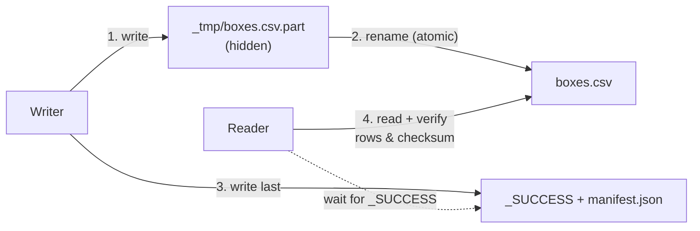

# Day 8 · Partial reads

!!! abstract "In one line"
    If a reader opens a file while the writer is still writing it, it silently gets half the data. Write somewhere hidden and rename in one step, signal "done" with a marker, and check counts against a manifest before loading.

<span class="dd-fix">atomic rename</span> <span class="dd-fix">success marker</span> <span class="dd-fix">manifest check</span>

## The story: half-empty Diwali boxes 🪔

Diwali. A company ordered **200 sweet boxes** for its staff, **₹1,00,000**. But half the boxes they gifted were **empty**, and the company cancelled next year's order.

Raju's family packs boxes in the back: kaju katli, laddoo, soan papdi. Two hundred boxes take **two hours**. But the company's driver came after **one hour**. He saw boxes stacked up, loaded them all, and drove off. Half were still waiting for sweets.

In a shop it's one embarrassing Diwali. **In apps**, one system writes a file and another reads it while it's still being written: half the rows, wrong totals, and nobody knows. That is a **partial read**.

## Why it happens in real systems

| Cause | Example |
|---|---|
| Polling a folder | A job runs every 5 minutes and picks up any file it finds, even one mid-upload |
| File-arrival triggers | A storage event fires when a file is *created*, before it is complete |
| Multi-file datasets | Spark writes 200 part files; a reader lists the folder after 120 |
| Big uploads over slow networks | An SFTP or partner upload is cut off; the half file stays behind |
| Overwrite in place | A job truncates and rewrites `sales.csv` while dashboards are reading it |

The worst part: **nothing errors**. The CSV is valid, just short, and the totals are quietly wrong.



## The problem in numbers

The [code](https://github.com/datadukaan/datadukaan.github.io/tree/main/code/day-08-partial-reads) uses `data/diwali_boxes.csv`: 200 boxes at ₹500. A writer thread writes them one row at a time; a reader thread (the driver) reads halfway through.

??? example "A real race between a writer and a reader (`01_partial_read.py`)"
    ```python
    --8<-- "day-08-partial-reads/01_partial_read.py"
    ```

```text
boxes ordered : 200  (Rs 100,000)
boxes read    : 79  (Rs 39,500)   <- partial read, no error
```

(The exact count depends on timing; that's the point. Run it twice and you can get two different "totals".)

## Fix 1: Atomic rename

**Raju:** packs in the **back room**. Only **sealed** boxes go to the counter.
**The app:** writes to a hidden temporary name (`_tmp/boxes.csv.part`), and only when it's complete **renames** it to the real name in one step. On the same filesystem a rename is atomic: a reader sees either no file or the whole file.

??? example "Write to temp, then os.replace (`02_atomic_rename.py`)"
    ```python
    --8<-- "day-08-partial-reads/02_atomic_rename.py"
    ```

```text
what the reader saw on each check: [0, 200]
=> only 0 (not there yet) or 200 (complete). Never a partial file.
```

!!! warning "Cloud object stores are different"
    On S3, ADLS and GCS a "rename" of a folder is really copy + delete, file by file, so it is **not** atomic for multi-file datasets. A single object upload is atomic, though: it appears complete or not at all. For folders, use Fix 2, or a table format (Delta Lake, Iceberg) whose commits are atomic.

## Fix 2: Success marker

**Raju:** lights a **diya** at the counter when the order is ready. No diya? Don't load anything.
**The app:** writes an empty `_SUCCESS` file into the folder **after** every part file is committed. Spark does this for you; downstream jobs (or an Airflow `FileSensor`) wait for it.

??? example "Spark's _SUCCESS + wait-for-marker (`03_success_marker.py`)"
    ```python
    --8<-- "day-08-partial-reads/03_success_marker.py"
    ```

```text
folder after Spark's write:
  _SUCCESS                                           0 bytes
  part-00000-….snappy.parquet                     1519 bytes
  part-00001-….snappy.parquet                     1520 bytes
_SUCCESS found -> read 200 boxes
```

## Fix 3: Manifest check

**Raju:** counts the boxes before the van leaves. Two hundred ordered, two hundred loaded.
**The app:** the writer also publishes a `manifest.json` with each file's **row count** and **checksum**. The reader recounts and refuses to load on any mismatch, which catches files cut short in transit that a marker alone can't.

??? example "Row count + SHA-256 manifest (`04_manifest_check.py`)"
    ```python
    --8<-- "day-08-partial-reads/04_manifest_check.py"
    ```

```text
Delivery 1 (complete):
  boxes.csv: rows 200/200, checksum match -> LOAD
Delivery 2 (upload cut short):
  boxes.csv: rows 120/200, checksum MISMATCH -> REJECT
```

| Fix | Protects against | Doesn't protect against |
|---|---|---|
| Atomic rename | Reading one file mid-write | Multi-file folders on object stores |
| `_SUCCESS` marker | Reading a folder before all parts land | A file that was corrupted or truncated before the marker |
| Manifest (counts + checksums) | Truncated or corrupted files | Wrong data that was written completely |
| Table format (Delta / Iceberg) | All of the above for table readers: atomic commits | Readers that list raw files instead of using the table |

## Where this lives in your tools

```sql
--8<-- "day-08-partial-reads/platform_notes.sql"
```

## When to use what

| Situation | Approach |
|---|---|
| Single files on local disk or HDFS | Write to temp + atomic rename |
| Spark / Hadoop output folders | Wait for `_SUCCESS` (Airflow `FileSensor`, or check before reading) |
| Files from partners (SFTP, email, uploads) | Upload to a temp name or folder + manifest with counts and checksums |
| Lakehouse tables | Use Delta Lake / Iceberg: readers only see committed versions |
| Event-triggered ingestion (Auto Loader, storage events) | Producer writes to a staging prefix and moves when done |

## Interview questions

??? question "What is a partial read and why is it dangerous?"
    Reading a file or folder before the writer finishes. It's dangerous because nothing fails: the data is valid but incomplete, so totals are silently wrong.

??? question "Why is writing to a temp file and renaming safe?"
    On POSIX filesystems a rename within one filesystem is atomic: other processes see the old state or the new one, never a half-renamed file. So readers get no file or a complete file.

??? question "What is the _SUCCESS file in Spark output?"
    An empty marker the Hadoop output committer writes after all task outputs are committed. Its presence means the folder is complete; downstream jobs wait for it.

??? question "How do Delta Lake and Iceberg avoid partial reads?"
    Writes add data files that readers ignore until a single atomic commit is added to the transaction log (or metadata pointer). Readers always see a consistent snapshot.

## Run it yourself

```bash
git clone https://github.com/datadukaan/datadukaan.github.io.git
cd datadukaan.github.io && pip install -r requirements.txt
cd code/day-08-partial-reads
python 01_partial_read.py     # the problem
python 02_atomic_rename.py    # Fix 1
python 03_success_marker.py   # Fix 2 (needs Java 17+ for PySpark)
python 04_manifest_check.py   # Fix 3
```

## Further reading

- [Python: os.replace (atomic rename)](https://docs.python.org/3/library/os.html#os.replace)
- [Delta Lake: concurrency control and ACID transactions](https://docs.delta.io/latest/concurrency-control.html)
- [Airflow: FileSensor](https://airflow.apache.org/docs/apache-airflow/stable/howto/operator/file.html)
- [Amazon S3: consistency model](https://docs.aws.amazon.com/AmazonS3/latest/userguide/Welcome.html#ConsistencyModel)

---

*Watch the short version on [Instagram](https://instagram.com/datadukaan) or [YouTube](https://youtube.com/@datadukaan). Previous: [Day 7](day-07-rate-limits.md). Next: Day 9.*

**Happy Diwali from Data Dukaan! 🪔**
