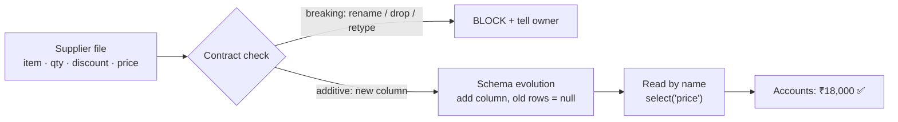

# Day 9 · Schema drift

!!! abstract "In one line"
    When a source adds, moves or renames a column, pipelines that read by **position** silently pick the wrong numbers, or crash. Read columns by name, let additive changes evolve the schema safely, and agree on the format in a data contract.

<span class="dd-fix">read by name</span> <span class="dd-fix">schema evolution</span> <span class="dd-fix">data contract</span>

## The story: Raju pays ₹1,800 instead of ₹18,000

Raju thought he paid his supplier **₹18,000** this month. He actually paid **₹1,800**. The supplier called, furious: "No more stock until you pay!"

Every month the supplier's bill has three columns: item, quantity, **price**. Raju's son copies the **third** column into the accounts. But this month the supplier added a new column, **discount**, before price. Now the third column was discount, not price. The son didn't notice and copied it anyway.

In a shop it's one wrong bill. **In apps**, one team adds a column to their data, and every pipeline that reads by position picks the wrong numbers or crashes, overnight, across hundreds of reports. That is **schema drift**.

## Why it happens in real systems

| Change at the source | What breaks downstream |
|---|---|
| New column inserted in the middle | Positional CSV parsing, `SELECT *` into fixed tables, `columns[2]` code |
| Column renamed (`price` → `amount`) | Every query that names the old column; dashboards go blank |
| Column type changed (int → string, `"9,000"`) | Casts fail, or numbers become null |
| Column removed | Jobs crash, or a default silently fills in |
| Nested JSON field added | Strict schemas reject the record; loose ones drop it |



## The problem in numbers

The [sample bills](https://github.com/datadukaan/datadukaan.github.io/tree/main/code/day-09-schema-evolution): October (`item, qty, price`), November (a new `discount` column before `price`), and December (`price` renamed to `amount`, a breaking change).

??? example "Reading by position (`01_read_by_position.py`)"
    ```python
    --8<-- "day-09-schema-evolution/01_read_by_position.py"
    ```

```text
october   columns=['item', 'qty', 'price']  -> column 3 is 'price', total Rs 18,000
november  columns=['item', 'qty', 'discount', 'price']  -> column 3 is 'discount', total Rs 1,800
november read with the October schema:
+----+-----+-----+
|item|  qty|price|
|Rice|50 kg|  900|     <- the discount, labelled "price"
| Oil| 20 L|  400|
| Dal|30 kg|  500|
```

No error at all. A fixed positional schema is just as bad: it stamps the old names onto the new columns.

## Fix 1: Read by name

**Raju:** reads the **heading**, not the position, and finds the column named "price".
**The app:** selects columns **by name**. New columns anywhere don't matter, and a missing column fails loudly instead of returning wrong numbers.

??? example "select('price') (`02_read_by_name.py`)"
    ```python
    --8<-- "day-09-schema-evolution/02_read_by_name.py"
    ```

```text
october   total Rs 18,000
november  total Rs 18,000
december (price renamed to amount): fails loudly -> AnalysisException
    [UNRESOLVED_COLUMN.WITH_SUGGESTION] ... `price` cannot be resolved.
    Did you mean one of the following? [`item`, `qty`, `amount`, `discount`]
```

A loud failure is the good outcome here: it's caught tonight, not discovered in next month's accounts.

## Fix 2: Schema evolution

**Raju:** a new column appears? Add it to the ledger. Don't panic, don't crash.
**The app:** accepts **additive** changes automatically: the table gains the new column, old rows get `null`, and the pipeline keeps going.

??? example "mergeSchema and unionByName (`03_schema_evolution.py`)"
    ```python
    --8<-- "day-09-schema-evolution/03_schema_evolution.py"
    ```

```text
+----+-----+--------+-----+--------+
|item|  qty|discount|price|   month|
| Dal|30 kg|     500| 5000|november|
| Oil| 20 L|     400| 4000|november|
|Rice|50 kg|     900| 9000|november|
| Dal|30 kg|    NULL| 5000| october|
| Oil| 20 L|    NULL| 4000| october|
|Rice|50 kg|    NULL| 9000| october|
unionByName(allowMissingColumns=True) rows: 6
```

| Schema mode | New column arrives | Renamed / removed column | Good for |
|---|---|---|---|
| Positional / no checks | Silent wrong data | Silent wrong data | Nothing |
| Enforcement (Delta default) | Write **fails** | Write fails | Curated tables where every change is reviewed |
| Evolution (`mergeSchema`) | Column **added**, old rows null | Still fails (needs a decision) | Raw / bronze layers, additive sources |
| Rescue column (Auto Loader) | Unknown fields kept in `_rescued_data` | Kept for later | Messy JSON from many producers |

!!! warning "Evolve additive changes only"
    Adding a column is safe to automate. Renaming, dropping or changing a type is a decision, not a default: let those fail, and handle them deliberately (Delta column mapping can rename without rewriting data).

## Fix 3: Data contract

**Raju:** tells the supplier, "Change your bill? **Tell me first.**" They agree on the format, in writing.
**The app:** producer and consumers sign a **data contract**: the columns consumers rely on, their types, what's allowed to change, and who to tell. Every file is checked against it before loading.

```json
--8<-- "day-09-schema-evolution/contract_supplier_bill.json"
```

??? example "Check files against the contract (`04_data_contract.py`)"
    ```python
    --8<-- "day-09-schema-evolution/04_data_contract.py"
    ```

```text
data/bill_october.csv              PASS
data/bill_november.csv             PASS (new columns ['discount'] allowed)
data/bill_december_breaking.csv    BLOCKED
    - missing required column 'price'
```

The new `discount` column is an allowed, additive change; the rename is stopped **before** it reaches the accounts.

## Where this lives in your tools

```sql
--8<-- "day-09-schema-evolution/platform_notes.sql"
```

## When to use what

| Situation | Approach |
|---|---|
| Any code that reads data | Select columns by name; never `SELECT *` into fixed targets or index by position |
| Raw / bronze ingestion | Schema evolution for new columns (`mergeSchema`, Auto Loader `addNewColumns`) |
| Curated / gold tables | Schema enforcement + reviewed migrations |
| Data from another team or company | A data contract, checked in CI and at load time |
| Messy, fast-changing JSON | Keep unknown fields in a rescue column; alert on new ones |

## Interview questions

??? question "What is schema drift and how do you detect it?"
    Unplanned changes to a source's structure: new, removed, renamed or retyped columns. Detect it by comparing each incoming file's schema with the expected one (contract or last known), failing or alerting on breaking changes, and logging additive ones.

??? question "What's the difference between schema enforcement and schema evolution in Delta Lake?"
    Enforcement (the default) rejects writes whose schema doesn't match the table. Evolution (`mergeSchema` / autoMerge) lets compatible additive changes, like new columns, be added to the table during the write.

??? question "Why is reading by position dangerous?"
    Any inserted or reordered column shifts the meaning of every position after it, and the job keeps running with wrong values. Reading by name either still works or fails loudly.

??? question "What goes into a data contract?"
    The dataset's owner and consumers, column names and types, required/nullable rules, allowed and breaking changes, freshness/quality expectations, and how changes are versioned and communicated.

## Run it yourself

```bash
git clone https://github.com/datadukaan/datadukaan.github.io.git
cd datadukaan.github.io && pip install -r requirements.txt
cd code/day-09-schema-evolution
python 01_read_by_position.py   # the problem (needs Java 17+ for PySpark)
python 02_read_by_name.py       # Fix 1
python 03_schema_evolution.py   # Fix 2
python 04_data_contract.py      # Fix 3
```

## Further reading

- [Delta Lake: schema enforcement and evolution](https://docs.delta.io/latest/delta-batch.html#schema-validation)
- [Delta Lake: column mapping (rename and drop columns)](https://docs.delta.io/latest/delta-column-mapping.html)
- [Spark: Parquet schema merging](https://spark.apache.org/docs/latest/sql-data-sources-parquet.html#schema-merging)
- [dbt: model contracts](https://docs.getdbt.com/docs/collaborate/govern/model-contracts)
- [Snowflake: table schema evolution](https://docs.snowflake.com/en/user-guide/data-load-schema-evolution)

---

*Watch the short version on [Instagram](https://instagram.com/datadukaan) or [YouTube](https://youtube.com/@datadukaan). Previous: [Day 8](day-08-partial-reads.md). Next: Day 10.*
