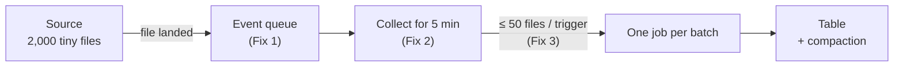

# Day 10 · The small files problem

!!! abstract "In one line"
    Thousands of tiny files mean thousands of job start-ups and endless folder listings, so the pipeline spends its time on overhead, not data. Get told when files land, process them in batches, and cap how much each batch takes.

<span class="dd-fix">file notification</span> <span class="dd-fix">micro-batching</span> <span class="dd-fix">batch trigger</span>

## The story: India vs Pakistan night 🏏

India versus Pakistan. Two thousand orders came in on the app, and half of them were **cancelled**: Raju lost **₹20,000**.

Every order printed one slip. Raju's son ran to the printer, grabbed **one** slip, packed it, and ran back. Then he checked the printer again, even when nothing had printed. Two thousand trips, one slip at a time. By the second innings he was exhausted and the orders were late.

In a shop it's one tired son. **In apps**, sources drop millions of tiny files, and the pipeline starts a job per file and keeps listing the folder to look for new ones. The overhead is huge; the actual data is tiny. That is the **small files problem**.

## Why it happens in real systems

| Source | Example |
|---|---|
| Streaming / IoT sinks | Kafka Connect or Event Hubs Capture flushing a file every few seconds |
| One file per event or API call | A webhook writes one JSON file per order |
| Over-partitioned writes | `partitionBy("date", "store", "hour")` on a small table |
| Frequent small appends | A job appending a few rows every minute to a Delta / Parquet table |
| Too many Spark tasks | 200 shuffle partitions writing 200 files of a few KB each |

Every file costs a LIST entry, an open, metadata, and often a whole job or task. Ten thousand 50 KB files are far slower to read than one 500 MB file.



## The problem in numbers

The [code](https://github.com/datadukaan/datadukaan.github.io/tree/main/code/day-10-small-files) drops 2,000 order slips of ~57 bytes each, then processes them the son's way: one job per file, polling the folder again and again.

??? example "One job per file + polling (`01_small_files_problem.py`)"
    ```python
    --8<-- "day-10-small-files/01_small_files_problem.py"
    ```

```text
files         : 2000  (avg 57 bytes each)
jobs started  : 2000   <- one per file
folder LISTs  : 5  (each lists all 2000 files, even when nothing is new)
time          : 4.3s, mostly job start-up, not real work
```

With a real Spark job taking seconds to start, 2,000 jobs is over an hour of overhead for 114 KB of data.

## Fix 1: File notification

**Raju:** puts a **bell** on the printer. The son only goes when it rings.
**The app:** the storage service publishes a "file landed" event to a queue (Azure Event Grid, S3 → SQS, GCS → Pub/Sub). The pipeline reads the queue instead of listing the folder.

??? example "Events instead of LIST calls (`02_file_notification.py`)"
    ```python
    --8<-- "day-10-small-files/02_file_notification.py"
    ```

```text
files received via events: 10
folder LIST calls        : 0
```

## Fix 2: Micro-batching

**Raju:** slips collect in a **tray**. Every five minutes the son packs the whole tray in one trip.
**The app:** gathers files for a short window and processes them together as one job, then compacts them so later readers open one big file, not thousands.

??? example "One job per window (`03_micro_batching.py`)"
    ```python
    --8<-- "day-10-small-files/03_micro_batching.py"
    ```

```text
  batch 1:  431 files, Rs 17,240
  batch 2:  430 files, Rs 17,200
  batch 3:  441 files, Rs 17,640
  batch 4:  446 files, Rs 17,840
  batch 5:  252 files, Rs 10,080
files processed : 2000
jobs started    : 5   (was 2000)
compacted into  : compacted/orders.jsonl (1 file)
```

(Batch sizes depend on timing; the job count is what matters.)

## Fix 3: Batch trigger

**Raju:** sets a rule: **"50 slips or 5 minutes, whichever comes first."**
**The app:** caps each batch (`maxFilesPerTrigger`) and sets how often it runs (`trigger(processingTime="5 minutes")`). Batches stay small enough to be fast and big enough to be efficient, even during a match-night spike.

??? example "Spark Structured Streaming with maxFilesPerTrigger (`04_batch_trigger.py`)"
    ```python
    --8<-- "day-10-small-files/04_batch_trigger.py"
    ```

```text
batch 0: 50 files
batch 1: 50 files
batch 2: 50 files
batch 3: 50 files
batch 4: 30 files
230 files -> 5 jobs, never more than 50 files each
```

| Fix | Solves | Doesn't solve |
|---|---|---|
| File notification | Expensive LIST polling on huge folders | Job-per-file overhead |
| Micro-batching | Thousands of job start-ups | A sudden spike making one batch huge |
| Batch trigger (size + time cap) | Unpredictable batch sizes and latency | Small files already sitting in the table |
| Compaction (`OPTIMIZE`, auto compact) | Slow reads from many small files in storage | Overhead during ingestion |

## Where this lives in your tools

```sql
--8<-- "day-10-small-files/platform_notes.sql"
```

## When to use what

| Situation | Approach |
|---|---|
| Huge landing folder, files arrive all day | Auto Loader / Snowpipe with file notifications |
| Many tiny files per minute | Micro-batch streaming with `processingTime` trigger |
| Spiky arrivals (sales, match nights) | `maxFilesPerTrigger` / `maxBytesPerTrigger` caps |
| Table already full of small files | `OPTIMIZE`, auto compaction, fewer partition columns |
| You control the writer | Write fewer, bigger files: buffer, `coalesce`, optimized writes |

## Interview questions

??? question "What is the small files problem?"
    When data is stored as many tiny files, the per-file overhead (listing, opening, metadata, task scheduling) dominates the real work. Reads and ingestion slow down, and metadata services (NameNode, object-store LIST, table logs) get overloaded.

??? question "Directory listing vs file notification mode in Auto Loader?"
    Listing mode scans the input path to find new files, which gets slow and costly as folders grow. Notification mode subscribes to storage events through a queue, so new files are discovered without listing; it scales to millions of files.

??? question "What do maxFilesPerTrigger and a processing-time trigger do?"
    `maxFilesPerTrigger` caps how many new files one micro-batch takes. `trigger(processingTime=...)` sets how often a micro-batch starts. Together they bound batch size and latency.

??? question "How do you fix small files that are already in a Delta table?"
    Run `OPTIMIZE` (optionally with Z-ORDER / liquid clustering) to rewrite them into larger files, and enable optimized writes and auto compaction so new writes don't recreate the problem.

## Run it yourself

```bash
git clone https://github.com/datadukaan/datadukaan.github.io.git
cd datadukaan.github.io && pip install -r requirements.txt
cd code/day-10-small-files
python 01_small_files_problem.py   # the problem
python 02_file_notification.py     # Fix 1
python 03_micro_batching.py        # Fix 2
python 04_batch_trigger.py         # Fix 3 (needs Java 17+ for PySpark)
```

## Further reading

- [Databricks: Auto Loader file notification mode](https://docs.databricks.com/en/ingestion/cloud-object-storage/auto-loader/file-notification-mode.html)
- [Spark: Structured Streaming triggers](https://spark.apache.org/docs/latest/structured-streaming-programming-guide.html#triggers)
- [Delta Lake: optimizations (OPTIMIZE, compaction)](https://docs.delta.io/latest/optimizations-oss.html)
- [Snowflake: Snowpipe auto-ingest](https://docs.snowflake.com/en/user-guide/data-load-snowpipe-auto)

---

*Watch the short version on [Instagram](https://instagram.com/datadukaan) or [YouTube](https://youtube.com/@datadukaan). Previous: [Day 9](day-09-schema-evolution.md). Next: Day 11.*

**🎉 Module 1 complete: how data arrives.** Next up, Module 2: storing data.
