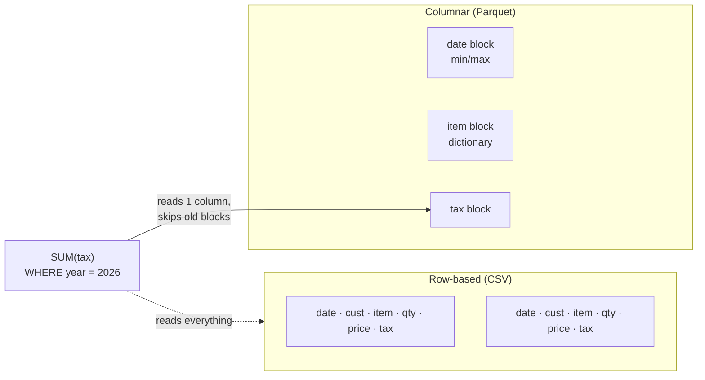

# Day 11 · Columnar formats

!!! abstract "In one line"
    Row-based files like CSV store each record together, so a report that needs one column still reads every column of every row. Columnar formats like Parquet store each column separately, compress repeated values, and keep min/max stats so readers skip what they don't need.

<span class="dd-fix">columnar format</span> <span class="dd-fix">compression</span> <span class="dd-fix">predicate pushdown</span>

*Module 2 begins: storing data.*

## The story: a GST notice and 10,000 bills

A **GST notice** for Raju: "Tell us your total tax for the year by tomorrow morning, or pay a **₹50,000 penalty**."

Raju's register has **one line per bill**: date, customer, item, quantity, price, tax. He only needs the **tax column**, but it's mixed into every line. So his son reads **all 10,000 bills**, line by line, just to pick one number from each. Midnight, and he's still on page 400.

In a shop it's one sleepless night. **In apps**, data saved row by row (like CSV) means a report that needs one column reads **every column of every row**: terabytes scanned, slow reports, a huge cloud bill. That is **row-based storage** used for analytics.

## Why it happens in real systems

| Situation | Why it hurts |
|---|---|
| Reports on raw CSV / JSON dumps | Every query parses whole lines, all columns |
| Wide tables (100+ columns) | A dashboard uses 5 columns but pays for 100 |
| Pay-per-scan engines (Athena, BigQuery, Synapse serverless) | You are billed for bytes read, so wasted columns cost money |
| No statistics in the files | Filters like "this year only" still read every file |
| OLTP database used for analytics | Row stores are built for single-record reads/writes, not column scans |



## The problem in numbers

The [code](https://github.com/datadukaan/datadukaan.github.io/tree/main/code/day-11-columnar-formats) creates Raju's register: **1,000,000 bills** from Jan 2025 to Nov 2026, saved as a 33 MB CSV.

??? example "Create the register (`make_data.py`)"
    ```python
    --8<-- "day-11-columnar-formats/make_data.py"
    ```

??? example "SUM(tax) from CSV (`01_row_based_read.py`)"
    ```python
    --8<-- "day-11-columnar-formats/01_row_based_read.py"
    ```

```text
columns parsed : 6 of 6  (needed: 1)
bytes read     : 33.0 MB (the whole file)
total tax      : Rs 7,152,883
```

## Fix 1: Columnar format

**Raju:** keeps a **separate notebook for each column**. Add up the tax notebook: ten minutes.
**The app:** stores data **column by column** (Parquet, ORC, and Delta / Iceberg tables built on Parquet) and reads only the columns a query uses. This is called **column pruning**.

??? example "Write Parquet, read only tax (`02_columnar_format.py`)"
    ```python
    --8<-- "day-11-columnar-formats/02_columnar_format.py"
    ```

```text
file size      : 2.5 MB
bytes read     : 0.6 MB (only the tax column)
total tax      : Rs 7,152,883
```

Same answer, **33 MB → 0.6 MB** read.

| | Row-based (CSV, JSON, Avro, OLTP tables) | Columnar (Parquet, ORC) |
|---|---|---|
| Best for | Writing / reading whole records, streaming, transactions | Analytics: few columns, many rows |
| Reading 1 of 6 columns | Reads all 6 | Reads 1 |
| Compression | Weak (mixed types per line) | Strong (similar values together) |
| Updating one record | Easy | Rewrite a file (table formats help) |

## Fix 2: Compression

**Raju:** "samosa" is written a thousand times in the item notebook. He writes it **once**: "samosa × 1000".
**The app:** Parquet uses **dictionary encoding** (store each distinct value once, then small IDs) and **run-length encoding** (store "same value × N"), then a codec like snappy or zstd.

??? example "CSV vs Parquet sizes (`03_compression.py`)"
    ```python
    --8<-- "day-11-columnar-formats/03_compression.py"
    ```

```text
bills.csv                      33.0 MB
bills.parquet (none)            2.5 MB   13.0x smaller
bills.parquet (snappy)          2.5 MB   13.0x smaller
bills.parquet (zstd)            2.4 MB   14.0x smaller

item column encodings: ('PLAIN', 'RLE', 'RLE_DICTIONARY')
'samosa' appears 474,712 times, stored once in the dictionary
```

Most of the saving comes from the encodings, before any codec runs: a column of the same few values is very cheap to store.

## Fix 3: Predicate pushdown

**Raju:** writes the **first and last date** at the top of every page. Need only this year? Skip the old pages without opening them.
**The app:** every Parquet row group stores **min and max** per column. The query's filter (the *predicate*) is pushed down to the reader, which skips any block whose range can't match.

??? example "Row-group stats and skipping (`04_predicate_pushdown.py`)"
    ```python
    --8<-- "day-11-columnar-formats/04_predicate_pushdown.py"
    ```

```text
row group 0: min 2025-01-01  max 2025-03-11  -> skip
row group 1: min 2025-03-11  max 2025-05-20  -> skip
row group 2: min 2025-05-20  max 2025-07-29  -> skip
row group 3: min 2025-07-29  max 2025-10-07  -> skip
row group 4: min 2025-10-07  max 2025-12-15  -> skip
row group 5: min 2025-12-16  max 2026-02-23  -> read
row group 6: min 2026-02-23  max 2026-05-04  -> read
row group 7: min 2026-05-04  max 2026-07-13  -> read
row group 8: min 2026-07-13  max 2026-09-21  -> read
row group 9: min 2026-09-21  max 2026-11-29  -> read

WHERE bill_date >= '2026-01-01': read 5 of 10 row groups
pyarrow   : 477,077 bills in 2026, tax Rs 3,411,712
duckdb    : 477,077 bills in 2026, tax Rs 3,411,713
```

Spark shows both fixes in its plan: only 2 columns read, and the filter pushed into the scan.

??? example "PySpark plan (`05_spark_parquet.py`)"
    ```python
    --8<-- "day-11-columnar-formats/05_spark_parquet.py"
    ```

```text
PushedFilters: [IsNotNull(bill_date), GreaterThanOrEqual(bill_date,2026-01-01)]
ReadSchema: struct<bill_date:date,tax:double>
tax 2026: Rs 3,411,712
```

!!! warning "Skipping only works if the data is sorted"
    Our bills were written in date order, so each block covers a narrow date range. If dates were shuffled, every block would span Jan 2025 to Nov 2026 and nothing could be skipped. That's why Delta has `ZORDER` / liquid clustering, and Snowflake has clustering keys.

## Where this lives in your tools

```sql
--8<-- "day-11-columnar-formats/platform_notes.sql"
```

## When to use what

| Situation | Approach |
|---|---|
| Landing raw data from apps / partners | Keep the CSV/JSON as-is in raw, convert to Parquet/Delta in the next layer |
| Analytics tables, dashboards | Parquet-based tables (Delta / Iceberg); select only the columns you need |
| Filters on dates or IDs | Sort or cluster by that column (`ZORDER`, liquid clustering, partitioning by date) |
| Streaming / message payloads | Row formats (Avro, JSON); they're written one record at a time |
| Transactions, single-record lookups | A row-store database (Postgres, MySQL) |

## Interview questions

??? question "Why is Parquet faster than CSV for analytics?"
    It stores data column by column, so queries read only the columns they need; similar values sit together and compress well; and per-row-group statistics let readers skip blocks. CSV must be fully parsed, every time.

??? question "What is predicate pushdown?"
    Pushing a query's filter down to the storage reader, so it uses file and row-group statistics (min/max, null counts) to skip data that can't match, instead of reading everything and filtering afterwards.

??? question "What is the difference between column pruning and predicate pushdown?"
    Column pruning skips **columns** the query doesn't use (vertical). Predicate pushdown skips **rows / blocks** that can't match the filter (horizontal). Together, a query reads only the cells it needs.

??? question "When would you not use a columnar format?"
    For write-heavy, record-at-a-time workloads: OLTP transactions, streaming messages, or frequent single-row updates. Row formats (Avro, JSON) or a row-store database fit those better.

## Run it yourself

```bash
git clone https://github.com/datadukaan/datadukaan.github.io.git
cd datadukaan.github.io && pip install -r requirements.txt
cd code/day-11-columnar-formats
python make_data.py               # 1,000,000 bills as CSV
python 01_row_based_read.py       # the problem
python 02_columnar_format.py      # Fix 1 (also writes data/bills.parquet)
python 03_compression.py          # Fix 2
python 04_predicate_pushdown.py   # Fix 3
python 05_spark_parquet.py        # PySpark plan (needs Java 17+)
```

## Further reading

- [Apache Parquet: file format](https://parquet.apache.org/docs/file-format/)
- [Apache Parquet: encodings](https://parquet.apache.org/docs/file-format/data-pages/encodings/)
- [Spark: Parquet files](https://spark.apache.org/docs/latest/sql-data-sources-parquet.html)
- [Delta Lake: data skipping and Z-order](https://docs.delta.io/latest/optimizations-oss.html)
- [Snowflake: micro-partitions and clustering](https://docs.snowflake.com/en/user-guide/tables-clustering-micropartitions)

---

*Watch the short version on [Instagram](https://instagram.com/datadukaan) or [YouTube](https://youtube.com/@datadukaan). Previous: [Day 10](day-10-small-files.md). Next: Day 12.*
