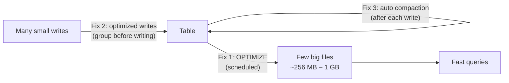

# Day 12 · Compaction

!!! abstract "In one line"
    When every small save creates a new file, tables end up with millions of tiny files and queries spend their time opening files instead of reading data. Merge them into big files (compaction), write fewer and bigger files in the first place (optimized writes), and merge automatically after each write (auto compaction).

<span class="dd-fix">compaction (OPTIMIZE)</span> <span class="dd-fix">optimized writes</span> <span class="dd-fix">auto compaction</span>

## The story: a ₹2 lakh wedding order 💍

Wedding season. A caterer asks Raju, "How much **rice** did I buy from you this year? Tell me now, and I'll give you my **₹2 lakh** order."

Raju keeps every bill as a **loose slip** in a big box: **5,000 slips**. His son opens each one, reads it, puts it back. One hour. Two hours. The caterer says "Forget it" and walks to the next shop.

On [Day 10](day-10-small-files.md), files were **arriving** in tiny pieces. Today they're **piling up**. **In apps**, every small save creates a new file, and a table ends up with millions of tiny files. Every query opens each one and spends more time opening files than reading data. That is the **small files problem, in storage**.

## Why it happens in real systems

| Cause | Example |
|---|---|
| Streaming / micro-batch appends | A job appends every minute: 1,440 new files a day per partition |
| Many writer tasks × many partitions | 200 shuffle tasks writing into 30 date partitions = up to 6,000 files |
| Over-partitioning | `partitionBy("date", "store", "hour")` on a small table |
| Frequent MERGE / UPDATE / DELETE | Each change rewrites some files into new, smaller ones |
| CDC and row-by-row loads | One file per batch of a few hundred rows |

Each file costs a listing, an open, a footer read and a scheduled task. Thousands of 4 KB files are far slower to read than one big file holding the same rows.



## The problem in numbers

The [code](https://github.com/datadukaan/datadukaan.github.io/tree/main/code/day-12-compaction) makes 2,000 small appends of 250 bills each: 2,000 Parquet files averaging 4 KB. Then it asks the caterer's question with DuckDB.

??? example "Create the tiny files (`make_data.py`)"
    ```python
    --8<-- "day-12-compaction/make_data.py"
    ```

??? example "One query, 2,000 files (`01_small_files_problem.py`)"
    ```python
    --8<-- "day-12-compaction/01_small_files_problem.py"
    ```

```text
files          : 2,000  (avg 4.2 KB)
rice this year : 1,080,781 kg
query time     : 175 ms
```

175 ms for 8 MB of data. Scale that to millions of files on cloud storage, where each open is a network call, and queries take minutes.

## Fix 1: Compaction (OPTIMIZE)

**Raju:** every Sunday, he binds the week's slips into **one register**.
**The app:** rewrites many small files into a few big ones. In Delta Lake that's `OPTIMIZE`; it bin-packs files towards a target size (about 1 GB by default) and commits the swap atomically, so readers never see a half-done compaction.

??? example "Bin-pack 2,000 files into 3 (`02_compaction.py`)"
    ```python
    --8<-- "day-12-compaction/02_compaction.py"
    ```

```text
before: 2,000 files, avg     4.2 KB  ->  rice 1,080,781 kg in 140 ms
after :     3 files, avg   652.3 KB  ->  rice 1,080,781 kg in 3 ms
```

Same answer, about **50× faster**. (Timings vary by machine; the file count is what matters.)

## Fix 2: Optimized writes

**Raju:** his son stops making a slip for **every sale** and writes the whole day on **one sheet**.
**The app:** groups rows by partition **before** writing, so each partition gets one (or a few) files instead of one per writer task. In Spark that's `repartition("month")` before `partitionBy("month")`; Delta's `optimizeWrite` does the shuffle for you.

??? example "550 files vs 11 (`03_optimized_writes.py`)"
    ```python
    --8<-- "day-12-compaction/03_optimized_writes.py"
    ```

```text
naive write     :  550 files for 11 months
optimized write :   11 files for 11 months
```

50 tasks × 11 months = 550 files in the naive write; one task per month = 11.

## Fix 3: Auto compaction

**Raju:** why wait for Sunday? When the box hits **50 slips**, the son binds them right away.
**The app:** after each write, it checks for small files and merges them automatically (Delta `autoCompact`, Databricks predictive optimization). No separate job to schedule or forget.

??? example "Compact after every write (`04_auto_compaction.py`)"
    ```python
    --8<-- "day-12-compaction/04_auto_compaction.py"
    ```

```text
after write   49:  49 files (49 small)
after write   50:   1 files (0 small)
after write   51:   2 files (1 small)
after write  500:  10 files (0 small)
after write 1000:  20 files (0 small)
after write 2000:  40 files (0 small)
compactions run: 40; files left: 40 instead of 2,000
```

| Fix | When it runs | Cost | Good for |
|---|---|---|---|
| `OPTIMIZE` (scheduled) | Nightly / weekly job | Rewrites data; compute you schedule | Any table; large one-off cleanups |
| Optimized writes | During each write | An extra shuffle per write | Partitioned tables, many writer tasks |
| Auto compaction | Right after each write | Adds a little time to writes | Streaming / frequent small appends |

!!! warning "Old files stay until VACUUM"
    Compaction writes new files and marks the old ones as removed in the table log, so time travel still works. The old files keep using storage until you `VACUUM` (Day 18).

## Where this lives in your tools

```sql
--8<-- "day-12-compaction/platform_notes.sql"
```

## When to use what

| Situation | Approach |
|---|---|
| Table already full of small files | Run `OPTIMIZE` (Iceberg: `rewrite_data_files`) |
| Streaming or micro-batch ingestion | Auto compaction on the table, plus a periodic `OPTIMIZE` |
| Batch jobs writing partitioned tables | Optimized writes, or `repartition` by the partition column |
| Small tables | Don't over-partition; one partition column at most, or none |
| Snowflake | File sizes are managed for you; size your load files ~100–250 MB |

## Interview questions

??? question "What is the small files problem and why does it hurt?"
    Data stored as many tiny files. Each file adds fixed overhead (listing, opening, reading the footer, scheduling a task, storing metadata), so queries spend more time on overhead than on reading data, and metadata systems get overloaded.

??? question "What does OPTIMIZE do in Delta Lake?"
    It bin-packs small files into larger ones (towards a target size, ~1 GB by default), writes the new files, and commits one atomic transaction that removes the old files from the table. Readers see either the old or the new layout. With `ZORDER BY` it also co-locates related values for data skipping.

??? question "Optimized writes vs auto compaction?"
    Optimized writes shuffle data before writing, so each partition gets fewer, bigger files. Auto compaction runs after a write and merges small files that already exist. The first prevents small files; the second cleans them up as they appear.

??? question "Why not just make every file huge?"
    Very large files reduce parallelism and make updates and deletes rewrite more data. Common targets are ~128 MB to 1 GB depending on table size and how often rows change.

## Run it yourself

```bash
git clone https://github.com/datadukaan/datadukaan.github.io.git
cd datadukaan.github.io && pip install -r requirements.txt
cd code/day-12-compaction
python make_data.py               # 2,000 tiny Parquet files
python 01_small_files_problem.py  # the problem
python 02_compaction.py           # Fix 1
python 03_optimized_writes.py     # Fix 2 (needs Java 17+ for PySpark)
python 04_auto_compaction.py      # Fix 3
```

## Further reading

- [Delta Lake: optimizations (OPTIMIZE, Z-order, auto compaction, optimized writes)](https://docs.delta.io/latest/optimizations-oss.html)
- [Databricks: configure Delta Lake to control data file size](https://docs.databricks.com/en/delta/tune-file-size.html)
- [Apache Iceberg: maintenance (rewrite data files)](https://iceberg.apache.org/docs/latest/maintenance/)
- [Spark: DataFrameWriter.partitionBy](https://spark.apache.org/docs/latest/api/python/reference/pyspark.sql/api/pyspark.sql.DataFrameWriter.partitionBy.html)

---

*Watch the short version on [Instagram](https://instagram.com/datadukaan) or [YouTube](https://youtube.com/@datadukaan). Previous: [Day 11](day-11-columnar-formats.md). Next: Day 13.*
