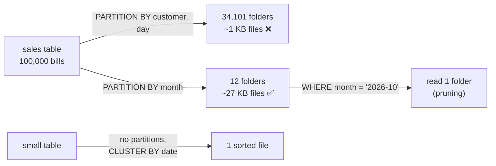

# Day 13 · Partitioning

!!! abstract "In one line"
    Partitioning splits a table into folders. Split by a column with many values (customer, minute) and you get millions of tiny folders that make every query slower. Partition big tables by a low-cardinality column like date or month, filter on it so engines prune folders, and don't partition small tables at all: cluster them instead.

<span class="dd-fix">low-cardinality partition key</span> <span class="dd-fix">partition pruning</span> <span class="dd-fix">clustering</span>

## The story: the supplier's truck 🚚

The supplier's truck is waiting outside Raju's shop. "Tell me how much **sugar** you sold last month. Every hour I wait costs you **₹2,000**."

Last week Raju's son got organised. He built a cupboard with **one drawer for every customer, for every day**: **10,000 drawers**, most holding just one slip. To count sugar he opens drawer after drawer after drawer. Three hours, **₹6,000** gone just for waiting.

In a shop it's one silly cupboard. **In apps**, tables are split into folders called **partitions**. Split by customer or by minute and you get millions of tiny folders; every query lists them, opens them, and crawls. That is **over-partitioning**.

## Why it happens in real systems

| Choice | Result |
|---|---|
| `partitionBy("customer_id")` | One folder per customer: hundreds of thousands of folders |
| Partition by timestamp or hour on a small table | 8,760 folders a year, each with a few KB |
| Two or three partition columns | Folders multiply: 100 customers × 365 days = 36,500 |
| Partitioning a table that is only a few GB | Every partition is tiny, so there's nothing to prune |
| Filtering on a column that isn't the partition key | No pruning at all; partitions only add overhead |



## The problem in numbers

The [code](https://github.com/datadukaan/datadukaan.github.io/tree/main/code/day-13-partitioning) writes 100,000 bills from 100 customers in 2026, partitioned by **customer and day**, then asks the supplier's question with DuckDB.

??? example "Write both layouts (`make_data.py`)"
    ```python
    --8<-- "day-13-partitioning/make_data.py"
    ```

??? example "Over-partitioned query (`01_over_partitioning.py`)"
    ```python
    --8<-- "day-13-partitioning/01_over_partitioning.py"
    ```

```text
folders        : 34,101
avg file size  : 1.0 KB  (1.5 bills per file)
sugar in Oct   : 14,127 kg
query time     : 2348 ms
```

1.5 bills per file. The engine spends its time listing and opening 34,101 folders.

## Fix 1: Low-cardinality partition key

**Raju:** keeps **one drawer per month**. Just twelve.
**The app:** partitions by a column with **few distinct values** (date, month, region, country), so each partition holds plenty of data.

??? example "Customer + day vs month (`02_low_cardinality_key.py`)"
    ```python
    --8<-- "day-13-partitioning/02_low_cardinality_key.py"
    ```

```text
customer + day : 34,101 folders, avg file     1.0 KB -> sugar 14,127 kg in  2438 ms
month          :     12 folders, avg file    26.9 KB -> sugar 14,127 kg in     4 ms
```

Same answer, **2.4 s → 4 ms**. (Timings vary by machine.)

| Partition column | Distinct values | Verdict |
|---|---|---|
| `customer_id`, `order_id`, timestamp | Thousands to millions | ❌ Too many folders |
| `date` (for big tables) | 365 a year | ✅ If each day holds ~1 GB+ |
| `month`, `region`, `country` | Tens | ✅ Good for medium-large tables |
| none | 1 | ✅ For tables under ~1 TB: cluster instead |

## Fix 2: Partition pruning

**Raju:** the supplier wants last month? Open **one drawer**, ignore the other eleven.
**The app:** when a query filters on the partition column, the engine reads **only the matching folders**. Pyarrow, DuckDB and Spark all show it.

??? example "Reading 1 of 12 folders (`03_partition_pruning.py`)"
    ```python
    --8<-- "day-13-partitioning/03_partition_pruning.py"
    ```

```text
pyarrow : WHERE month = '2026-10' -> reads 1 of 12 folders' files
duckdb  : Scanning Files: 1/12
spark   : PartitionFilters: [isnotnull(month#4), (month#4 = 2026-10)]
sugar in Oct: 14,127 kg
```

!!! warning "Pruning only works on the partition column"
    `WHERE month = '2026-10'` prunes. `WHERE bill_date >= '2026-10-01'` on a table partitioned by `month` may not, unless the engine knows how they relate. Delta's **generated columns** (see below) let you partition by month while users filter by date.

## Fix 3: Clustering (don't partition small tables)

**Raju:** the small tea-stall notebook needs **no drawers**. One notebook is enough.
**The app:** small and medium tables aren't partitioned at all. The data is **sorted** (clustered) instead, so min/max statistics still let readers skip blocks ([Day 11](day-11-columnar-formats.md)). Day 14 goes deeper.

??? example "365 tiny files vs 1 sorted file (`04_clustering_small_table.py`)"
    ```python
    --8<-- "day-13-partitioning/04_clustering_small_table.py"
    ```

```text
partitioned by day : 365 files, avg 0.8 KB each
clustered          : 1 file (21 KB), 10 row groups sorted by date
October query      : reads 2 of 10 row groups (min/max skipping, Day 11)
```

## Where this lives in your tools

```sql
--8<-- "day-13-partitioning/platform_notes.sql"
```

## When to use what

| Situation | Approach |
|---|---|
| Table under ~1 TB | No partitions; `CLUSTER BY` / Z-order on common filters |
| Large table, queries filter by date | Partition by date or month (≥ ~1 GB per partition) |
| Queries filter by a high-cardinality ID | Cluster / Z-order by it; never partition by it |
| Users filter by a timestamp | Partition by a generated month/date column |
| Snowflake / BigQuery | Snowflake: clustering keys. BigQuery: partition by date + cluster by columns |

## Interview questions

??? question "What is over-partitioning and why is it bad?"
    Partitioning by columns with too many distinct values (or too many columns), producing huge numbers of small folders and files. Listing, opening and tracking them dominates query time, and metadata grows, while each partition holds too little data to benefit.

??? question "How do you choose a partition column?"
    Pick a low-cardinality column that most queries filter on (usually a date or month), and make sure each partition holds a meaningful amount of data (around 1 GB or more on Delta). If the table is small, don't partition.

??? question "What is partition pruning?"
    When a query filters on the partition column, the engine uses the folder structure (or table metadata) to skip partitions that can't match, reading only the relevant folders. Spark shows it as `PartitionFilters` in the plan.

??? question "Partitioning vs clustering?"
    Partitioning physically separates data into folders by exact values: great for coarse, low-cardinality filters on large tables. Clustering (sorting, Z-order, liquid clustering) keeps related values close within files so min/max statistics skip data. It works for high-cardinality columns and small tables without creating more folders.

## Run it yourself

```bash
git clone https://github.com/datadukaan/datadukaan.github.io.git
cd datadukaan.github.io && pip install -r requirements.txt
cd code/day-13-partitioning
python make_data.py                 # ~1 minute: writes ~34,000 folders
python 01_over_partitioning.py      # the problem
python 02_low_cardinality_key.py    # Fix 1
python 03_partition_pruning.py      # Fix 2 (needs Java 17+ for PySpark)
python 04_clustering_small_table.py # Fix 3
```

## Further reading

- [Databricks: when to partition tables](https://docs.databricks.com/en/tables/partitions.html)
- [Databricks: liquid clustering](https://docs.databricks.com/en/delta/clustering.html)
- [Delta Lake: generated columns](https://docs.delta.io/latest/delta-batch.html#use-generated-columns)
- [Spark: partition discovery](https://spark.apache.org/docs/latest/sql-data-sources-parquet.html#partition-discovery)
- [Snowflake: clustering keys](https://docs.snowflake.com/en/user-guide/tables-clustering-keys)

---

*Watch the short version on [Instagram](https://instagram.com/datadukaan) or [YouTube](https://youtube.com/@datadukaan). Previous: [Day 12](day-12-compaction.md). Next: [Day 14 · Clustering & Z-ordering](day-14-clustering.md).*
