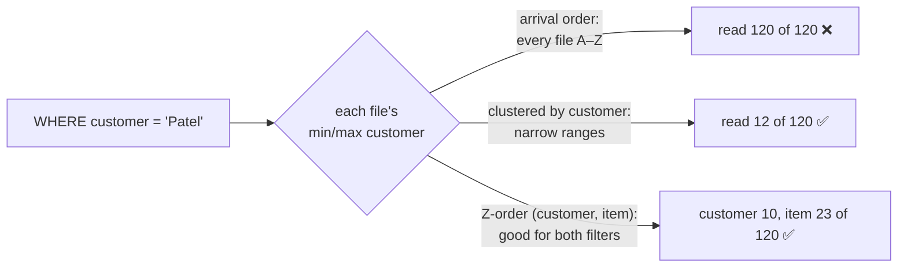

# Day 14 · Clustering, Z-ordering & data skipping

!!! abstract "In one line"
    A table split by date still gets fully scanned when people filter by customer or product, because those values are scattered across every file. Files keep min/max stats so engines can skip (data skipping), but that only works when similar rows sit together (clustering), and Z-ordering keeps them together for two columns at once.

<span class="dd-fix">data skipping</span> <span class="dd-fix">clustering</span> <span class="dd-fix">Z-ordering</span>

## The story: Patel's ₹40,000 dispute

Patel Caterers is angry. "Show me every bill I got from you this year, or I won't pay the **₹40,000** I owe."

Raju's bills are in **twelve monthly files**, just like [Day 13](day-13-partitioning.md). But Patel's bills are scattered inside every file, between hundreds of other customers. So his son reads every page of every month: twelve files, **6,000 bills**, four hours.

**In apps**, tables are split by date, but people filter by customer or by product. One customer's data is spread across every file, so the query reads them all. That is a **full table scan**.

## Why it happens in real systems

| Situation | Why everything is scanned |
|---|---|
| Partitioned by date, filtered by customer / product / ID | Every partition contains every customer |
| Rows written in arrival order | Each file holds a random mix of customers, so min/max spans A–Z |
| High-cardinality filters (IDs, emails, SKUs) | Can't partition by them (Day 13), and nothing else orders them |
| Different teams filter on different columns | Sorting for one column doesn't help the other |
| Many small appends | New files are unsorted until something reorganises them |



## The problem in numbers

The [code](https://github.com/datadukaan/datadukaan.github.io/tree/main/code/day-14-clustering) writes 600,000 bills from 500 customers as 12 monthly files of 10 blocks (row groups) each, in arrival order. A block can be skipped only if its min/max can't contain the value.

??? example "Create the data (`make_data.py`) and the block counter (`common.py`)"
    ```python
    --8<-- "day-14-clustering/make_data.py"
    ```
    ```python
    --8<-- "day-14-clustering/common.py"
    ```

??? example "Filter by customer (`01_full_table_scan.py`)"
    ```python
    --8<-- "day-14-clustering/01_full_table_scan.py"
    ```

```text
Patel's bills: 1,174, total Rs 2,951,310
WHERE customer = 'Patel Caterers' : reads 120 of 120 blocks (100%)
```

## Fix 1: Data skipping

**Raju:** writes the **first and last name** on top of each page. "A to D"? Patel isn't there: skip it.
**The app:** every file (and every Parquet row group) stores the **min and max** of each column. Before reading, the engine compares the filter with those ranges and skips what can't match. Delta, Iceberg, Snowflake micro-partitions and BigQuery all do this automatically.

??? example "Skipping works on date, not on customer (`02_data_skipping.py`)"
    ```python
    --8<-- "day-14-clustering/02_data_skipping.py"
    ```

```text
March, block 0, bill_date: min 2026-03-01  max 2026-03-03
March, block 0, customer : min Cust 001  max Patel Caterers
WHERE bill_date = '2026-03-15'    : reads   2 of 120 blocks (2%)
WHERE customer = 'Patel Caterers' : reads 120 of 120 blocks (100%)
```

Dates arrive in order, so their ranges are narrow and skipping works. Customers arrive mixed, so every block says "Cust 001 to Patel Caterers": nothing can be skipped.

## Fix 2: Clustering

**Raju:** arranges the bills **by customer name**, like a library shelves books by topic.
**The app:** sorts the data inside files by the column people filter on, so each file covers a narrow range and data skipping starts working. On Databricks that's **liquid clustering** (`CLUSTER BY`); in Snowflake, a **clustering key**.

??? example "Sort by customer inside each file (`03_clustering.py`)"
    ```python
    --8<-- "day-14-clustering/03_clustering.py"
    ```

```text
March, block 0: customers Cust 001 .. Cust 050
March, block 9: customers Cust 450 .. Patel Caterers
before (arrival order)            : reads 120 of 120 blocks (100%)
after CLUSTER BY customer         : reads  12 of 120 blocks (10%)
but WHERE item = 'sugar'          : reads 120 of 120 blocks (100%)
```

The last line is why Fix 3 exists: sorting by customer does nothing for item filters.

## Fix 3: Z-ordering

**Raju:** some days they ask by customer, some days by item, so he arranges for **both at once**.
**The app:** sorts by two (or more) columns together using a **Z-order curve**, which interleaves the bits of both values so rows close in *either* column end up close on disk. `OPTIMIZE … ZORDER BY (customer, item)` in Delta.

??? example "Linear sort vs Z-order (`04_z_ordering.py`)"
    ```python
    --8<-- "day-14-clustering/04_z_ordering.py"
    ```

```text
linear sort (customer, item)
  WHERE customer = 'Patel Caterers': reads   1 of 120 blocks (1%)
  WHERE item = 'sugar'            : reads 120 of 120 blocks (100%)
Z-order (customer, item)
  WHERE customer = 'Patel Caterers': reads  10 of 120 blocks (8%)
  WHERE item = 'sugar'            : reads  23 of 120 blocks (19%)
```

A linear sort is perfect for its first column and useless for the second. Z-order gives up a little on customer to make **both** filters skip most of the table.

| Approach | Best for | Trade-off |
|---|---|---|
| Data skipping (min/max) | Always on; free | Only helps when values are already grouped |
| Sort / cluster by one column | One dominant filter | Other filters still scan everything |
| Z-order on 2–4 columns | Several common filters | Each column skips less than a dedicated sort; rewrite needed |
| Liquid clustering (Databricks) | New Delta tables; keys that may change | Incremental; replaces partitioning + ZORDER |

## Where this lives in your tools

```sql
--8<-- "day-14-clustering/platform_notes.sql"
```

## When to use what

| Situation | Approach |
|---|---|
| Filters on a high-cardinality column (customer, SKU, ID) | Cluster / Z-order by it; never partition by it |
| One filter column dominates | Sort or cluster by that column |
| 2–4 columns filtered equally often | Z-order or multi-column liquid clustering |
| New Delta tables on Databricks | Liquid clustering instead of partitioning + ZORDER |
| Snowflake tables in the multi-TB range | Clustering key; check `SYSTEM$CLUSTERING_INFORMATION` |
| Small tables | Nothing: a full scan of a few MB is already fast |

## Interview questions

??? question "What is data skipping and why doesn't it always work?"
    Engines store min/max (and null counts) per file or row group and skip files whose range can't contain the filter value. It fails when values are randomly spread, because every file's range covers almost everything. Clustering or sorting makes the ranges narrow.

??? question "Partitioning vs clustering vs Z-ordering?"
    Partitioning splits data into folders by exact values of a low-cardinality column (date). Clustering sorts data within files so min/max ranges are narrow for a filter column, which works for high-cardinality columns. Z-ordering clusters on multiple columns at once using a space-filling curve.

??? question "How does a Z-order curve work?"
    It maps multi-dimensional values to one dimension by interleaving their bits (x1 y1 x2 y2 …). Points close in any dimension tend to stay close in the resulting order, so files end up with narrow ranges for each Z-ordered column.

??? question "When would you choose liquid clustering over ZORDER on Databricks?"
    For new Delta tables, especially where query patterns may change: clustering keys can be changed without rewriting the table, clustering is incremental, and it replaces both partitioning and Z-ordering. ZORDER needs full rewrites through OPTIMIZE and can't be combined with changing keys easily.

## Run it yourself

```bash
git clone https://github.com/datadukaan/datadukaan.github.io.git
cd datadukaan.github.io && pip install -r requirements.txt
cd code/day-14-clustering
python make_data.py           # 600,000 bills, 12 monthly files
python 01_full_table_scan.py  # the problem
python 02_data_skipping.py    # Fix 1
python 03_clustering.py       # Fix 2
python 04_z_ordering.py       # Fix 3
```

## Further reading

- [Delta Lake: data skipping and Z-ordering](https://docs.delta.io/latest/optimizations-oss.html)
- [Databricks: liquid clustering](https://docs.databricks.com/en/delta/clustering.html)
- [Snowflake: micro-partitions and data clustering](https://docs.snowflake.com/en/user-guide/tables-clustering-micropartitions)
- [BigQuery: clustered tables](https://cloud.google.com/bigquery/docs/clustered-tables)
- [Apache Parquet: metadata and statistics](https://parquet.apache.org/docs/file-format/metadata/)

---

*Watch the short version on [Instagram](https://instagram.com/datadukaan) or [YouTube](https://youtube.com/@datadukaan). Previous: [Day 13](day-13-partitioning.md). Next: [Day 15 · Medallion architecture](day-15-medallion.md).*
