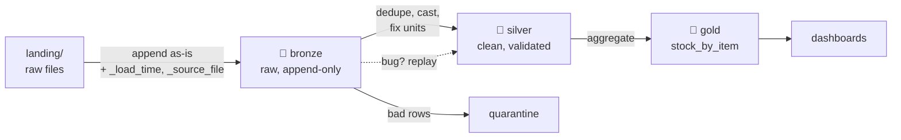

# Day 15 · Medallion architecture

!!! abstract "In one line"
    When raw data goes straight into dashboard tables, duplicates, wrong types and bad files break every report, and overwriting the raw data means you can't go back and fix it. That's a **data swamp**. Split the pipeline into three layers: **bronze** (raw, append-only, replayable), **silver** (cleaned and validated) and **gold** (business-ready).

<span class="dd-fix">bronze</span> <span class="dd-fix">silver</span> <span class="dd-fix">gold</span>

## The story: a stone in every plate of dal

**Data swamp.** It's why your dashboard says **500 kilos** of onions when you have **fifty**.

Two hundred wedding guests, and a stone in every plate of dal: Raju's son poured raw sacks straight into the pot. **In apps**, that's a pipeline writing raw data straight into the dashboard table. Duplicates, wrong types, one bad file, and every report breaks. Worse, the raw data is **overwritten**, so you can't go back and fix it.

## Why it happens in real systems

| Shortcut | What goes wrong |
|---|---|
| Load source files straight into reporting tables | Every source glitch reaches dashboards immediately |
| `CREATE OR REPLACE` / truncate-and-load on raw data | History is gone; a bug can't be fixed by reprocessing |
| Cleaning logic copied into every report | Five dashboards, five definitions of "stock" |
| Bad rows dropped silently | Nobody knows data went missing, or why |
| No lineage | "Where did this number come from?" has no answer |



## The problem in numbers

The [code](https://github.com/datadukaan/datadukaan.github.io/tree/main/code/day-15-medallion) has two days of supplier slips with the usual mess: one slip appears twice, onions are in grams, and one quantity is `x?`.

??? example "Raw slips (`landing/`)"
    ```text
    --8<-- "day-15-medallion/landing/slips_2026-11-16.csv"
    ```
    ```text
    --8<-- "day-15-medallion/landing/slips_2026-11-17.csv"
    ```

??? example "Straight into the dashboard (`01_data_swamp.py`)"
    ```python
    --8<-- "day-15-medallion/01_data_swamp.py"
    ```

```text
dashboard_stock after the 17-Nov load:  rice 50 kg · sugar x? kg · dal 0 kg
onions on the dashboard: 75,000 'kg'  (grams read as kg + a duplicate slip; real stock: 50 kg)
and the 16-Nov raw rows no longer exist in dashboard_stock, so they can't be re-checked
```

## Layer 1: Bronze

**Raju:** keep every sack exactly as it arrived. Don't touch it.
**The app:** land each file **as-is** into an **append-only** table. Store everything as text so nothing fails to load, and add **lineage columns**: when it was loaded and which file it came from. Never update or delete here.

??? example "Append with lineage (`02_bronze.py`)"
    ```python
    --8<-- "day-15-medallion/02_bronze.py"
    ```

```text
slip_id  item   qty    unit  _source_file
S001     onion  25000  g     slips_2026-11-16.csv
S002     onion  25000  g     slips_2026-11-16.csv
S002     onion  25000  g     slips_2026-11-16.csv   <- duplicate, kept
...
S006     sugar  x?     kg    slips_2026-11-17.csv   <- bad, kept
bronze rows: 8 (duplicates and bad rows kept on purpose)
```

## Layer 2: Silver

**Raju:** clean it. Remove the stones, throw out the rotten sack.
**The app:** **deduplicate** (one row per `slip_id`), **cast types** (`TRY_CAST`), **standardise units** (g → kg), and send rows that fail validation to a **quarantine** table with a reason, instead of dropping them.

??? example "Clean + quarantine (`03_silver.py`)"
    ```python
    --8<-- "day-15-medallion/03_silver.py"
    ```

```text
silver:      S001 onion 25 kg · S002 onion 25 kg · S003 dal 45 kg · S004 oil 20 L · S005 rice 50 kg · S007 dal 0 kg
quarantine:  S006 sugar x?  -> qty is not a number
```

## Layer 3: Gold

**Raju:** cook only the clean dal.
**The app:** build **business-ready** tables (daily sales, stock by item) from silver. Dashboards and reports read **only** gold, so every report shares one definition.

??? example "Stock by item (`04_gold.py`)"
    ```python
    --8<-- "day-15-medallion/04_gold.py"
    ```

```text
item   qty   unit  slips
dal    45.0  kg    2
oil    20.0  L     1
onion  50.0  kg    2
rice   50.0  kg    1
```

## Why bronze matters: replay

Silver v1 shipped with a bug: it forgot to convert grams. Because bronze kept every raw row, the fix is to correct the code and **rebuild silver and gold from bronze**, without asking the supplier to resend anything.

??? example "Fix and replay (`05_replay_from_bronze.py`)"
    ```python
    --8<-- "day-15-medallion/05_replay_from_bronze.py"
    ```

```text
silver v1 (bug: no unit conversion) -> gold onions: 50,000 kg
bronze rows still available        : 8
silver v2 replayed from bronze      -> gold onions: 50 kg
```

| Layer | Contains | Rules | Who reads it |
|---|---|---|---|
| Bronze | Raw data exactly as received + lineage | Append-only; never edit; keep everything | Data engineers (debug, replay) |
| Silver | Cleaned, typed, deduplicated, conformed rows | Validations; bad rows to quarantine; idempotent MERGE | Analysts, data scientists, other pipelines |
| Gold | Aggregates, business entities, marts | Business definitions; optimised for reads | Dashboards, reports, apps |

## Where this lives in your tools

```sql
--8<-- "day-15-medallion/platform_notes.sql"
```

## When to use what

| Situation | Approach |
|---|---|
| Any lakehouse pipeline with more than one source | Bronze → silver → gold |
| Sources that send messy or changing files | Bronze stores strings / VARIANT + rescued data; validate in silver |
| Need to explain a number | Lineage columns from bronze carried through silver |
| Rule changes or bugs | Rebuild silver/gold from bronze |
| Very simple, single-source reports | Two layers (raw + reporting) may be enough; don't over-engineer |

## Interview questions

??? question "What is the medallion architecture?"
    A layered lakehouse design: bronze holds raw data as ingested (append-only, with lineage), silver holds cleaned and validated data, and gold holds business-level tables for consumption. Each layer improves quality and structure, and each can be rebuilt from the one before.

??? question "Why keep bronze if silver has the clean data?"
    Bronze is the source of truth for what arrived. When a bug or business rule changes, you rebuild silver and gold from bronze instead of re-ingesting from sources, which may no longer have the data. It also answers audit questions: what exactly did the supplier send?

??? question "What do you do with bad records?"
    Don't silently drop them. Route them to a quarantine (or "rejected") table with the reason and source file, alert on volume, and reprocess after fixing. Delta Live Tables expectations can drop, fail or warn on violations.

??? question "Where do deduplication and type casting happen?"
    In silver. Bronze stays raw; silver applies dedup (often a MERGE on a business key), casting, standardisation and validation; gold applies business logic and aggregation.

## Run it yourself

```bash
git clone https://github.com/datadukaan/datadukaan.github.io.git
cd datadukaan.github.io && pip install -r requirements.txt
cd code/day-15-medallion
python 01_data_swamp.py          # the problem
python 02_bronze.py              # layer 1
python 03_silver.py              # layer 2
python 04_gold.py                # layer 3
python 05_replay_from_bronze.py  # fix a bug by replaying
```

## Further reading

- [Databricks: what is the medallion lakehouse architecture?](https://docs.databricks.com/en/lakehouse/medallion.html)
- [Databricks: Auto Loader](https://docs.databricks.com/en/ingestion/cloud-object-storage/auto-loader/index.html)
- [Databricks: manage data quality with pipeline expectations](https://docs.databricks.com/en/delta-live-tables/expectations.html)
- [Delta Lake: MERGE (upsert)](https://docs.delta.io/latest/delta-update.html#upsert-into-a-table-using-merge)

---

*Watch the short version on [Instagram](https://instagram.com/datadukaan) or [YouTube](https://youtube.com/@datadukaan). Previous: [Day 14](day-14-clustering.md). Next: Day 16.*
