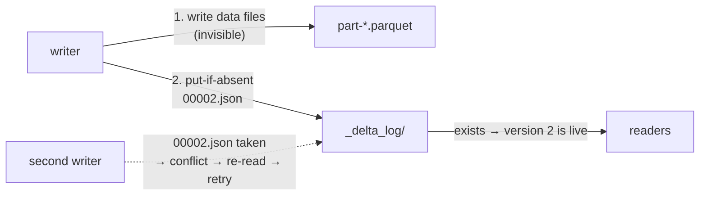

# Day 16 · ACID table formats

!!! abstract "In one line"
    On a plain folder of files, a job that crashes halfway leaves **half a change**, and two jobs writing at once silently **overwrite** each other. Table formats like Delta Lake and Iceberg add a transaction log, so writes are **atomic**, conflicting writers are **detected and retried**, and readers only ever see **finished versions**.

<span class="dd-fix">atomic commit</span> <span class="dd-fix">optimistic concurrency</span> <span class="dd-fix">snapshot isolation</span>

## The story: "Paisa kat gaya, ticket nahi mila"

**Partial write.** Every Indian has seen this message.

Tatkal, 10 AM sharp. Raju is booking two tickets for his nephew's wedding. **₹3,000** leaves his bank account. Then: "Booking failed." Money gone, no ticket, refund in 5 to 7 working days.

**In apps**, this is a write that stops halfway: step one done, step two crashed. In data tables, a job dies mid-write, or two jobs write at once, and everyone sees half a change.

!!! note "About the analogy"
    A real payment + railway booking spans two separate systems, so it isn't one ACID transaction (that needs patterns like sagas and refunds). It's an analogy for what a **single table** needs. The code below shows the real thing on a table.

## Why it happens in real systems

| Situation | What breaks |
|---|---|
| Spark / pandas job writing many files to a folder, then crashing | Readers see the files that made it: half the batch |
| Overwrite = delete old files, then write new ones | A reader in between sees an empty or half-full table |
| Two jobs read-modify-write the same table | The later write silently erases the earlier one (lost update) |
| Dashboard reads while a job is writing | Numbers mix old and new data |
| Object storage (S3/ADLS) "renames" folders file by file | No atomic swap of a whole dataset (Day 8) |



## The problem in numbers

The [code](https://github.com/datadukaan/datadukaan.github.io/tree/main/code/day-16-acid-tables) writes a batch of 72 Tatkal bookings as 6 Parquet files into a plain folder and crashes after 3. Then two threads book the last berth at the same moment.

??? example "Plain files, no transactions (`01_partial_write.py`)"
    ```python
    --8<-- "day-16-acid-tables/01_partial_write.py"
    ```

```text
writer: job crashed (out of memory)
reader sees 36 of 72 bookings  <- half a change, no error
berth 72: {'Raju': 'CONFIRMED', 'stranger': 'CONFIRMED'}  -> file says 'stranger': one confirmation is a lie
```

(The race is real, so the last line varies between runs. On one run the file even came out as `'Rajunger'`: two writes interleaved into garbage.)

## The building block: a tiny Delta-style table

Delta Lake's core idea fits in a page: data files plus a `_delta_log/` of numbered commits. A version exists **only when its log file exists**, and creating that file is **put-if-absent**: if `00000002.json` already exists, your create fails.

??? example "`tiny_delta.py` (~60 lines)"
    ```python
    --8<-- "day-16-acid-tables/tiny_delta.py"
    ```

## Fix 1: Atomic commit

**Raju:** money and ticket go together, or not at all.
**The app:** write the new data files **on the side**. They become real only when **one entry** is written in the **transaction log**. Crash before that, and readers see the previous version; the orphan files are ignored (and later removed by `VACUUM`, Day 18).

??? example "Crash before the commit (`02_atomic_commit.py`)"
    ```python
    --8<-- "day-16-acid-tables/02_atomic_commit.py"
    ```

```text
v0: 0 bookings
writer: job crashed after writing 3 files, before the commit
readers see v0: 0 bookings  <- nothing changed (3 orphan files are ignored)
rerun commits v1: readers see 72 bookings  <- all or nothing
```

## Fix 2: Optimistic concurrency

**Raju:** Raju and a stranger click "Book" for the last berth in the same second. Only one wins; the other sees "waiting list".
**The app:** writers don't lock the table. Each one remembers the **version it read**. At commit time, if that version has moved on, the commit fails with a **conflict**: re-read, re-check, retry.

??? example "Two writers, one berth (`03_optimistic_concurrency.py`)"
    ```python
    --8<-- "day-16-acid-tables/03_optimistic_concurrency.py"
    ```

```text
Raju    : read v0, committed v1 -> CONFIRMED
stranger: conflict (version 1 already exists: someone committed after you read v0) -> retry
stranger: read v1, berth taken -> WAITING LIST
table v1: berth 72 -> Raju
```

## Fix 3: Snapshot isolation

**Raju:** while bookings run, the seat chart shows only finished bookings. Never half.
**The app:** a reader **pins one version** and reads exactly the files in it, no matter what writers do meanwhile. The next query sees the new version, all at once. Old versions stay readable: time travel (Day 17).

??? example "Reader pinned to v7 (`04_snapshot_isolation.py`)"
    ```python
    --8<-- "day-16-acid-tables/04_snapshot_isolation.py"
    ```

```text
seat chart pins v7: 16 berths booked
  writer wrote 1/3 files for v8 -> chart (v7) still shows 16
  writer wrote 2/3 files for v8 -> chart (v7) still shows 16
  writer wrote 3/3 files for v8 -> chart (v7) still shows 16
writer commits v8: next refresh shows 22 berths, all at once
time travel still works: v7 = 16 berths
```

## The same guarantees in a real engine

??? example "DuckDB: rollback and write-write conflict (`05_duckdb_transactions.py`)"
    ```python
    --8<-- "day-16-acid-tables/05_duckdb_transactions.py"
    ```

```text
failed: booking service timed out -> rolled back
Raju's balance: 5000 (no paisa kat gaya)
stranger's transaction: TransactionContext Error: Conflict on update!
berth 72: Raju
```

| Property | What it means | How Delta / Iceberg do it |
|---|---|---|
| **A**tomic | A write lands completely or not at all | One log entry / metadata-pointer swap per commit |
| **C**onsistent | Every version follows the table's rules | Schema enforcement, constraints, checks at commit |
| **I**solated | Concurrent work doesn't see or break each other | Snapshot reads + optimistic concurrency on commit |
| **D**urable | Committed data survives crashes | Files and log in cloud storage |

## Where this lives in your tools

```sql
--8<-- "day-16-acid-tables/platform_notes.sql"
```

## When to use what

| Situation | Approach |
|---|---|
| Any table more than one job writes to, or anyone reads while it's written | Delta Lake / Iceberg / Hudi, not plain Parquet folders |
| Frequent conflicts between writers | Partition or cluster so writers touch disjoint data; retry with backoff |
| Delta on S3 with writers outside Databricks | A commit coordinator (DynamoDB LogStore) |
| Multi-step changes across tables | Do them in one job and publish last (e.g. swap a view), or use a warehouse transaction |
| Business flows across systems (payment + booking) | Sagas / outbox pattern with compensation (refunds), not one ACID transaction |

## Interview questions

??? question "How does Delta Lake make a write atomic?"
    New data files are written first and are invisible. The write becomes visible only when a single new JSON commit file is added to `_delta_log/`. Readers reconstruct the table from the log, so they see either the previous version or the new one, never a partial write.

??? question "What is optimistic concurrency control?"
    Writers don't lock; each records the version it read. At commit time the system checks whether conflicting commits happened since then. If so, the commit fails (e.g. `ConcurrentAppendException`) and the writer re-reads and retries. It works well when conflicts are rare.

??? question "What is snapshot isolation?"
    Each query reads a consistent snapshot: one committed version of the table. Writes in progress are invisible, and the snapshot doesn't change during the query even if new versions are committed.

??? question "Why isn't a folder of Parquet files enough?"
    It has no notion of a version or commit: readers list whatever files exist right now, so they can see partial writes, deletes in progress or a mix of two jobs. Overwrites aren't atomic, and nothing detects two writers clobbering each other.

## Run it yourself

```bash
git clone https://github.com/datadukaan/datadukaan.github.io.git
cd datadukaan.github.io && pip install -r requirements.txt
cd code/day-16-acid-tables
python 01_partial_write.py           # the problem
python 02_atomic_commit.py           # Fix 1
python 03_optimistic_concurrency.py  # Fix 2
python 04_snapshot_isolation.py      # Fix 3
python 05_duckdb_transactions.py     # a real engine
```

## Further reading

- [Delta Lake: transaction log protocol](https://github.com/delta-io/delta/blob/master/PROTOCOL.md)
- [Delta Lake: concurrency control](https://docs.delta.io/latest/concurrency-control.html)
- [Databricks: isolation levels and write conflicts](https://docs.databricks.com/en/optimizations/isolation-level.html)
- [Apache Iceberg: reliability and concurrency](https://iceberg.apache.org/docs/latest/reliability/)
- [DuckDB: transaction management](https://duckdb.org/docs/sql/statements/transactions.html)

---

*Watch the short version on [Instagram](https://instagram.com/datadukaan) or [YouTube](https://youtube.com/@datadukaan). Previous: [Day 15](day-15-medallion.md). Next: [Day 17 · Time travel](day-17-time-travel.md).*
