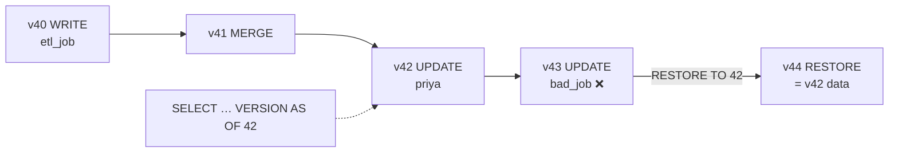

# Day 17 · Time travel & table versions

!!! abstract "In one line"
    An UPDATE or overwrite destroys the old values, so "what did this table say last week?" has no answer and a bad job can't be undone. Table formats keep **every write as a version**, so you can see the **history**, **query any past version** (time travel) and **restore** the table to before a mistake.

<span class="dd-fix">table history</span> <span class="dd-fix">time travel</span> <span class="dd-fix">restore</span>

## The story: lost history 🏏

**One wrong UPDATE.** Six months of data, gone. No undo, no replay. That's **lost history**.

A GST officer is at Raju's shop: "Show us your stock as on **31st March**." Raju's son updates the register every day **with an eraser**. March? Rubbed out. Penalty: **₹25,000**.

**In apps**, an UPDATE overwrites the old row and a bad job wipes a column. Then someone asks, "What did this report show last Friday?" The old data is gone.

The fix: think **DRS**. Cameras record every ball, the third umpire replays the exact moment, and a wrong decision is overturned.

## Why it happens in real systems

| Situation | What's lost |
|---|---|
| Daily full overwrite of a Parquet/CSV file | Every earlier day's numbers |
| `UPDATE` / `DELETE` / `MERGE` in place | The old values of the changed rows |
| A buggy job writes zeros or NULLs | The good data, with no way back except a re-load |
| Audit or regulator asks "as of" a date | You can't prove what the table said then |
| ML model trained "last month" | You can't reproduce its training data |



## The problem in numbers

The [code](https://github.com/datadukaan/datadukaan.github.io/tree/main/code/day-17-time-travel) writes Raju's stock table through the year as daily overwrites, then runs one wrong UPDATE that sets everything to 0.

??? example "Plain overwrites (`01_overwrite_loses_history.py`)"
    ```python
    --8<-- "day-17-time-travel/01_overwrite_loses_history.py"
    ```

```text
today        : 0 kg
31 March     : ?  (overwritten, no copy anywhere)
last Friday  : ?  (overwritten)
undo the bad UPDATE: impossible
```

## How versions work

Day 16's tiny table already kept a log of commits. Two more things make time travel possible: each commit records **who, when and what**, and old data files are **never modified**. A commit only adds a log entry that says which files are live. Rebuilding any version = replaying the log up to it.

??? example "`tiny_delta.py` with history, time travel and restore"
    ```python
    --8<-- "day-17-time-travel/tiny_delta.py"
    ```

## Fix 1: Table history

**Raju (DRS):** cameras record **every ball**.
**The app:** every write becomes a new **version** with commit info: version number, timestamp, user and operation. In Delta Lake: `DESCRIBE HISTORY stock`.

??? example "Every write is a version (`02_table_history.py`)"
    ```python
    --8<-- "day-17-time-travel/02_table_history.py"
    ```

```text
version  timestamp         user      operation
      5  2026-11-20 11:42  bad_job   UPDATE
      4  2026-11-20 09:00  etl_job   WRITE
      3  2026-11-13 18:30  priya     UPDATE
      2  2026-04-30 21:00  etl_job   WRITE
      1  2026-03-31 21:00  etl_job   WRITE
      0  2026-03-30 21:00  etl_job   WRITE
```

## Fix 2: Time travel

**Raju (DRS):** the third umpire replays **the exact moment**.
**The app:** query the table **as it was**, by version (`VERSION AS OF 3`) or by time (`TIMESTAMP AS OF '2026-03-31'`). A timestamp resolves to the latest version committed at or before it.

??? example "Read past versions (`03_time_travel.py`)"
    ```python
    --8<-- "day-17-time-travel/03_time_travel.py"
    ```

```text
today (after bad_job)     : 0 kg
VERSION AS OF 3           : 515 kg  (last Friday, priya's update)
TIMESTAMP AS OF 31 March  : 615 kg  (resolves to version 1)
    {'item': 'onion', 'qty_kg': 310}
    {'item': 'dal', 'qty_kg': 115}
    {'item': 'rice', 'qty_kg': 190}
```

The GST officer gets his answer: 615 kg on 31st March.

## Fix 3: Restore

**Raju (DRS):** wrong decision? **Overturned.**
**The app:** `RESTORE TABLE stock TO VERSION AS OF 4` makes a **new commit** whose live files are exactly those of v4. Nothing is deleted: the bad version is still in the history, so you can investigate it later.

??? example "Undo the bad job (`04_restore.py`)"
    ```python
    --8<-- "day-17-time-travel/04_restore.py"
    ```

```text
v5 (bad_job)      : 0 kg
RESTORE TO VERSION 4 -> new v6: 680 kg
history is kept, the mistake is still visible:
   v6  raju     RESTORE (restored v4)
   v5  bad_job  UPDATE
   v4  etl_job  WRITE
```

| Feature | Delta Lake | Snowflake | Iceberg |
|---|---|---|---|
| History | `DESCRIBE HISTORY` | Query history + Time Travel | `table.snapshots` metadata table |
| Read a past version | `VERSION AS OF n` / `TIMESTAMP AS OF` | `AT(TIMESTAMP => …)` / `BEFORE(STATEMENT => …)` | `FOR VERSION AS OF` / `FOR TIMESTAMP AS OF` |
| Undo | `RESTORE TABLE … TO VERSION AS OF` | `CLONE … BEFORE(…)`, `UNDROP` | `rollback_to_snapshot` |
| How far back | Log 30 days, data files 7 days after VACUUM (defaults) | 1 day default, up to 90 (Enterprise) | Until snapshots are expired |

!!! warning "Replays aren't kept forever"
    Time travel only works while the old files and log entries exist. `VACUUM` (Delta) and `expire_snapshots` (Iceberg) delete them to save storage. That's **Day 18**: retention.

## Where this lives in your tools

```sql
--8<-- "day-17-time-travel/platform_notes.sql"
```

## When to use what

| Situation | Approach |
|---|---|
| Audit / regulator: "what did it say on date X?" | `TIMESTAMP AS OF`, and keep retention long enough for your audit window |
| A bad job just ran | Inspect with `VERSION AS OF` + `EXCEPT`, then `RESTORE` |
| Reproduce an ML training set or a past report | Record the table version used, then read `VERSION AS OF` it |
| Need history beyond the retention window | Snapshot tables, SCD Type 2 (later in the series) or archived clones |

## Interview questions

??? question "How does Delta Lake time travel work?"
    Each commit adds a JSON entry to `_delta_log` listing files added and removed; data files themselves are immutable. To read version N, Delta replays the log up to N (using checkpoints) and reads only the files live at that version. A timestamp maps to the latest version committed at or before it.

??? question "What does RESTORE do, and does it delete history?"
    It creates a new commit that makes the live set of files equal to the target version's. It doesn't delete later versions: they stay in the history (until retention removes them), so the mistake can still be inspected.

??? question "What limits how far back you can time travel?"
    Retention. In Delta, `VACUUM` deletes data files no longer referenced by recent versions (default 7 days) and the log is kept for `delta.logRetentionDuration` (default 30 days). Snowflake's Time Travel window is 1 day by default, up to 90 days on Enterprise.

??? question "Is time travel a backup?"
    No. It lives in the same storage and account as the table, it expires, and dropping or vacuuming can remove it. Use it for quick recovery and audits; keep real backups or replicas for disasters.

## Run it yourself

```bash
git clone https://github.com/datadukaan/datadukaan.github.io.git
cd datadukaan.github.io && pip install -r requirements.txt
cd code/day-17-time-travel
python 01_overwrite_loses_history.py   # the problem
python 02_table_history.py             # Fix 1
python 03_time_travel.py               # Fix 2
python 04_restore.py                   # Fix 3
```

## Further reading

- [Delta Lake: table history and time travel](https://docs.delta.io/latest/delta-batch.html#query-an-older-snapshot-of-a-table-time-travel)
- [Databricks: work with Delta Lake table history](https://docs.databricks.com/en/delta/history.html)
- [Databricks: RESTORE](https://docs.databricks.com/en/sql/language-manual/delta-restore.html)
- [Snowflake: Time Travel](https://docs.snowflake.com/en/user-guide/data-time-travel)
- [Apache Iceberg: time travel queries](https://iceberg.apache.org/docs/latest/spark-queries/#time-travel)

---

*Watch the short version on [Instagram](https://instagram.com/datadukaan) or [YouTube](https://youtube.com/@datadukaan). Previous: [Day 16](day-16-acid-tables.md). Next: Day 18.*
