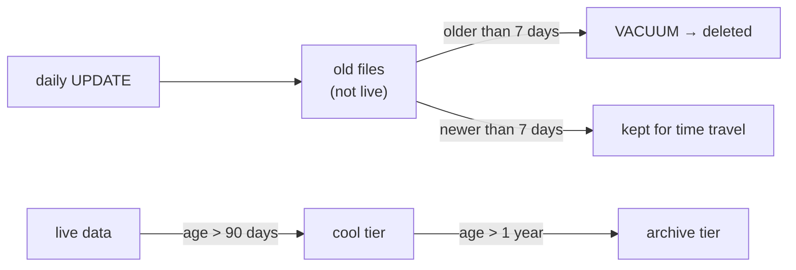

# Day 18 · Retention, VACUUM & cold tiers

!!! abstract "In one line"
    Table formats keep every old version (Day 17), so every UPDATE leaves files behind that nobody reads but you still pay for: **storage bloat**. **VACUUM** deletes files no recent version needs, a **retention policy** decides how long each table keeps history and rows, and **cold storage tiers** keep the old data you must keep at a fraction of the price.

<span class="dd-fix">VACUUM</span> <span class="dd-fix">retention policy</span> <span class="dd-fix">cold tier</span>

## The story: ₹15,000 a month, for garbage 🗑️

Raju rents a **godown** full of registers nobody opens, since 1998: **₹15,000 a month**.

Your data lake? Same. Every UPDATE leaves an **old file** behind. Nobody reads it. You still pay for it, every month. That's **storage bloat**.

Fix it in three moves: **throw out**, **set a rule**, **move it upstairs**.

## Why it happens in real systems

| Cause | Why files pile up |
|---|---|
| Daily overwrites / MERGE / UPDATE on Delta or Iceberg | Old files stay for time travel until VACUUM / expire_snapshots |
| OPTIMIZE (Day 12) | The small files it compacted stay on disk until VACUUM |
| Failed or aborted jobs | Orphan files never committed to any version |
| No row retention | Clickstream from 2019 that nobody queries |
| Everything in the hot tier | Years of compliance data billed at the most expensive rate |



## The problem in numbers

The [code](https://github.com/datadukaan/datadukaan.github.io/tree/main/code/day-18-retention-vacuum) overwrites a 50,000-row sales table every day for 60 days, using Day 17's tiny Delta-style table.

??? example "Build the table (`common.py`)"
    ```python
    --8<-- "day-18-retention-vacuum/common.py"
    ```

??? example "Live vs on disk (`01_storage_bloat.py`)"
    ```python
    --8<-- "day-18-retention-vacuum/01_storage_bloat.py"
    ```

```text
versions          : 60
live files        : 1  (0.4 MB)
files on disk     : 60  (24.8 MB)  <- you pay for this
wasted            : 98% of storage holds data no query reads
```

## Move 1: Throw out (VACUUM)

**Raju:** throws out pages no register needs anymore.
**The app:** `VACUUM` deletes data files that are **not part of the current version** and were **removed more than the retention window ago** (7 days by default in Delta). Recent versions keep working; older ones can no longer be time-travelled to.

??? example "`vacuum()` added to the tiny table (`tiny_delta.py`)"
    ```python
    --8<-- "day-18-retention-vacuum/tiny_delta.py"
    ```

??? example "VACUUM RETAIN 168 HOURS (`02_vacuum.py`)"
    ```python
    --8<-- "day-18-retention-vacuum/02_vacuum.py"
    ```

```text
dry run   : 52 files would be deleted
VACUUM RETAIN 168 HOURS: deleted 52 files, 24.8 MB -> 3.3 MB
latest version reads fine : 50,000 rows
time travel to 5 days ago (v55) : 50,000 rows
time travel to 1 October : FAILED, its files were vacuumed (the trade-off)
```

!!! warning "VACUUM ends time travel"
    After `VACUUM RETAIN 168 HOURS` you can only travel back 7 days. Keep the window longer than your longest-running job and your audit needs, and run `VACUUM … DRY RUN` first.

## Move 2: Set a rule (retention policy)

**Raju:** tax bills, 8 years. Rough notes, one week.
**The app:** decide per table **how long to keep history** (the VACUUM window) and **how long to keep rows** (delete old business data), write it down, and run it from one maintenance job, not ad hoc.

??? example "One policy, generated SQL (`03_retention_policy.py`)"
    ```python
    --8<-- "day-18-retention-vacuum/03_retention_policy.py"
    ```

```text
table           VACUUM RETAIN   delete rows older than reason
tax_invoices          720 HOURS   8 years                tax law
sales                 168 HOURS   3 years                reporting
clickstream           168 HOURS   90 days                analytics only
tmp_staging            24 HOURS   7 days                 scratch
```

| Setting (Delta) | Controls | Default |
|---|---|---|
| `delta.deletedFileRetentionDuration` | How old removed files must be before VACUUM deletes them | 7 days |
| `delta.logRetentionDuration` | How long commit history is kept | 30 days |
| `DELETE … WHERE date < …` + VACUUM | How long business rows are kept | forever, unless you do it |

## Move 3: Move it upstairs (cold tiers)

**Raju:** old registers he **must** keep go to the attic: cheap, just slower to fetch.
**The app:** cloud storage has tiers. Recent data stays **hot**; older partitions move to **cool** and then **archive** with lifecycle rules. Archive costs a fraction per GB, but reads are slow and cost extra.

??? example "3 years of data, hot vs tiered (`04_cold_tiering.py`)"
    ```python
    --8<-- "day-18-retention-vacuum/04_cold_tiering.py"
    ```

```text
hot (S3 Standard)                   600 GB  x $0.02300 = $   13.80/month
cool (S3 Standard-IA)             1,800 GB  x $0.01250 = $   22.50/month
archive (Glacier Deep Archive)    4,800 GB  x $0.00099 = $    4.75/month

everything hot : $165.60/month
tiered         : $41.05/month  (4.0x cheaper)
trade-off      : archive reads take hours and cost extra per GB retrieved
```

The archive tier alone is about **23× cheaper** per GB than hot (the video rounds it to "ten times"); the whole mix here is about 4× cheaper. Prices are approximate AWS list prices; Azure and GCS have equivalent tiers.

!!! warning "Don't archive files a table still reads"
    A Delta or Iceberg table expects its live files to be readable instantly. Tier **old partitions you've exported or archived out of the table**, or files VACUUM no longer protects, not live table files.

## Where this lives in your tools

```sql
--8<-- "day-18-retention-vacuum/platform_notes.sql"
```

## When to use what

| Situation | Approach |
|---|---|
| Delta table updated daily | Scheduled `VACUUM` (or predictive optimization), 7–14 day window |
| Audit needs "as of" 30+ days | Longer `deletedFileRetentionDuration`, or monthly snapshot tables |
| Event / log data | Row retention (e.g. 90 days) + VACUUM |
| Compliance data kept for years | Export old partitions, lifecycle to archive tier |
| Scratch / staging | Short retention; Snowflake transient tables |

## Interview questions

??? question "What does VACUUM do in Delta Lake, and what's the risk?"
    It deletes data files that aren't referenced by the current table version and are older than the retention threshold (7 days by default). It reduces storage cost, but time travel to versions older than the threshold stops working, and a too-short window can break long-running readers.

??? question "Why does storage keep growing on a table whose row count is flat?"
    Every UPDATE, MERGE, DELETE, overwrite or OPTIMIZE writes new files and only logically removes the old ones, for time travel. Until VACUUM runs, all those old files stay and are billed.

??? question "What's the difference between VACUUM and deleting old rows?"
    VACUUM removes old *versions* (physical files no longer live). Deleting rows removes old *business data* from the current version. To shrink storage for old rows you need both: DELETE, then VACUUM after the window.

??? question "How do cloud storage tiers trade off?"
    Colder tiers cost less per GB stored but more per read, have minimum storage durations, and (for archive) take hours to retrieve. Use lifecycle rules to move data by age, and keep anything queried regularly hot.

## Run it yourself

```bash
git clone https://github.com/datadukaan/datadukaan.github.io.git
cd datadukaan.github.io && pip install -r requirements.txt
cd code/day-18-retention-vacuum
python 01_storage_bloat.py     # the problem
python 02_vacuum.py            # Move 1
python 03_retention_policy.py  # Move 2
python 04_cold_tiering.py      # Move 3
```

## Further reading

- [Delta Lake: remove files no longer referenced (VACUUM)](https://docs.delta.io/latest/delta-utility.html#remove-files-no-longer-referenced-by-a-delta-table)
- [Databricks: VACUUM](https://docs.databricks.com/en/sql/language-manual/delta-vacuum.html)
- [Apache Iceberg: maintenance (expire snapshots, orphan files)](https://iceberg.apache.org/docs/latest/maintenance/)
- [Snowflake: storage costs for Time Travel and Fail-safe](https://docs.snowflake.com/en/user-guide/data-cdp-storage-costs)
- [Amazon S3: storage classes](https://aws.amazon.com/s3/storage-classes/)

---

*Watch the short version on [Instagram](https://instagram.com/datadukaan) or [YouTube](https://youtube.com/@datadukaan). Previous: [Day 17](day-17-time-travel.md). Next: [Day 19 · Snappy vs ZSTD](day-19-compression-codecs.md).*
