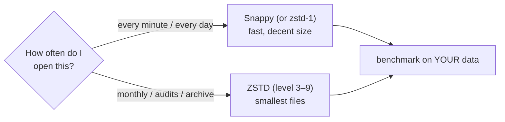

# Day 19 · Snappy vs ZSTD

!!! abstract "In one line"
    Every Parquet file is compressed with a **codec**. No compression means huge files and a huge bill; heavy, slow compression means every read waits to unpack. Ask one question, **how often do I open this?**, then use **Snappy** for fast hot data, **ZSTD** for smaller files (great for cold data), and **benchmark** on your own data, because the results often surprise you.

<span class="dd-fix">Snappy</span> <span class="dd-fix">ZSTD</span> <span class="dd-fix">benchmark</span>

## The story: Diwali rush 🪔

Fifty customers at the counter. Raju's stock is right there, and he **still can't sell it**. That's the **compression trade-off**.

To save godown rent, Raju's son packed all the stock in **tightly taped cartons**, stacked to the roof. Rent: half. He's a hero. Then Diwali: a customer wants one box of kaju katli. Tape, cutter, unpack, **five minutes**. The next customer walks out. By evening, **₹40,000** of sales has gone to the shop next door.

**In apps**, your data is those cartons. Store files loose and the cloud bill explodes; squeeze them too tight and every sale-day query waits to unpack.

## Why it happens in real systems

| Choice | What it costs |
|---|---|
| No compression (`none`) | 2–3× more storage, more network and disk I/O per query |
| gzip everywhere | Small files, but very slow writes (and slower reads than newer codecs) |
| Highest ZSTD level on hot ingest | Extra CPU on every write for little extra saving |
| Engine defaults never revisited | Spark writes snappy by default; Iceberg ≥ 1.4 writes zstd |
| Exporting CSV / JSON instead of Parquet | No columnar encoding at all (Day 11) |



## The problem in numbers

The [code](https://github.com/datadukaan/datadukaan.github.io/tree/main/code/day-19-compression-codecs) writes **2,000,000 Diwali orders** with every common codec and measures size, write time and read time.

??? example "Create the data (`make_data.py`)"
    ```python
    --8<-- "day-19-compression-codecs/make_data.py"
    ```

??? example "Codec benchmark (`01_codec_benchmark.py`)"
    ```python
    --8<-- "day-19-compression-codecs/01_codec_benchmark.py"
    ```

```text
codec       size MB  ratio  write s  read ms
none           21.7   1.0x     0.19       42
snappy         13.6   1.6x     0.19       53
gzip            8.4   2.6x    17.53       67
lz4            13.7   1.6x     0.20       63
zstd-1          7.5   2.9x     0.29       59
zstd-3          7.5   2.9x     0.25       57
zstd-9          7.5   2.9x     0.55       58
```

The real "taped carton" here is **gzip**: 90× slower to write than snappy. ZSTD is nearly half the size of snappy, and on this data it costs only a few milliseconds more to read.

## Fix 1: Snappy for hot data

**Raju:** daily sweets get **light packing**, open in seconds.
**The app:** Snappy is built for speed: very fast to compress and decompress, with a moderate size saving. It's Spark's default for Parquet and a safe choice for data that's written and read constantly.

??? example "Sale-day dashboard query (`02_hot_query.py`)"
    ```python
    --8<-- "day-19-compression-codecs/02_hot_query.py"
    ```

```text
none   :    4.9 ms per dashboard query
snappy :    3.8 ms per dashboard query
zstd3  :    4.2 ms per dashboard query
gzip   :    4.7 ms per dashboard query
```

Note that `none` isn't the fastest: reading more bytes from disk can cost more than decompressing fewer.

## Fix 2: ZSTD for smaller files

**Raju:** next year's diyas get **taped tight**; nobody opens them till October.
**The app:** ZSTD gives gzip-level (or better) compression at near-snappy speed, with tunable levels (1 is fastest, higher is smaller but slower to write). For cold, rarely-read data, the storage saving adds up every month.

??? example "3 years of cold data (`03_cold_storage_cost.py`)"
    ```python
    --8<-- "day-19-compression-codecs/03_cold_storage_cost.py"
    ```

```text
none   :   23.7 TB -> $      546/month
snappy :   14.9 TB -> $      343/month
zstd3  :    8.2 TB -> $      189/month
zstd9  :    8.2 TB -> $      188/month
gzip   :    9.2 TB -> $      213/month
```

Here, higher ZSTD levels don't save more: this data is already highly compressible after Parquet's own encodings (Day 11), so zstd-3 is the sweet spot.

| Codec | Size | Write speed | Read speed | Good for |
|---|---|---|---|---|
| none | Largest | Fastest | Fast-ish (more I/O) | Rarely a good idea |
| Snappy | Medium | Very fast | Very fast | Hot data, streaming writes, defaults |
| LZ4 | Medium | Very fast | Very fast | Similar to Snappy |
| ZSTD 1–3 | Small | Fast | Fast | Most tables, warm and cold |
| ZSTD 9+ | Small (sometimes smaller) | Slower | Fast | Archives written once |
| gzip | Small | Slow | Medium | Legacy compatibility only |

## Fix 3: Benchmark on your data

**Raju:** before Diwali, he **times one carton** both ways.
**The app:** codec results depend on your columns (strings vs numbers, repetition, sort order) and your engine. Run `01_codec_benchmark.py` on a sample of your own table before changing a default, and measure size, write time **and** your real query times.

## Where this lives in your tools

```sql
--8<-- "day-19-compression-codecs/platform_notes.sql"
```

## When to use what

| Situation | Approach |
|---|---|
| Not sure | ZSTD level 1–3: usually smaller than snappy at similar read speed |
| Latency-critical streaming writes | Snappy or LZ4 |
| Archive / audit tables | ZSTD 3+ (and a cold storage tier, Day 18) |
| Existing gzip files | Rewrite to ZSTD on the next OPTIMIZE / rewrite |
| Snowflake / BigQuery native tables | Managed for you; choose a codec only for exported files |

## Interview questions

??? question "Snappy vs ZSTD: which would you choose and why?"
    Snappy optimises speed with a moderate ratio; ZSTD gives a much better ratio at similar decompression speed, with tunable levels. For most analytics tables ZSTD (low level) is a good default; Snappy remains fine for very hot, write-heavy data. Benchmark on real data before deciding.

??? question "Why can uncompressed data be slower to query?"
    Queries are often I/O-bound: reading 2–3× more bytes from disk or object storage can cost more time than decompressing a smaller file in CPU.

??? question "Does changing the codec change existing files?"
    No. A table property or Spark setting applies to new files. Existing files keep their codec until they are rewritten, for example by OPTIMIZE or a full rewrite.

??? question "How do compression codecs relate to Parquet encodings?"
    Parquet first encodes column pages (dictionary, RLE, bit-packing), then compresses each page with the codec. Good encodings (helped by sorting/clustering) shrink data before the codec even runs.

## Run it yourself

```bash
git clone https://github.com/datadukaan/datadukaan.github.io.git
cd datadukaan.github.io && pip install -r requirements.txt
cd code/day-19-compression-codecs
python make_data.py              # 2M orders
python 01_codec_benchmark.py     # size, write, read per codec
python 02_hot_query.py           # Fix 1: hot dashboard query
python 03_cold_storage_cost.py   # Fix 2: cold storage cost
```

## Further reading

- [Apache Parquet: compression](https://parquet.apache.org/docs/file-format/data-pages/compression/)
- [Spark: Parquet configuration (compression codec)](https://spark.apache.org/docs/latest/sql-data-sources-parquet.html#configuration)
- [Apache Iceberg: write properties](https://iceberg.apache.org/docs/latest/configuration/#write-properties)
- [Zstandard (zstd)](https://facebook.github.io/zstd/)

---

*Watch the short version on [Instagram](https://instagram.com/datadukaan) or [YouTube](https://youtube.com/@datadukaan). Previous: [Day 18](day-18-retention-vacuum.md). Next: Day 20.*
