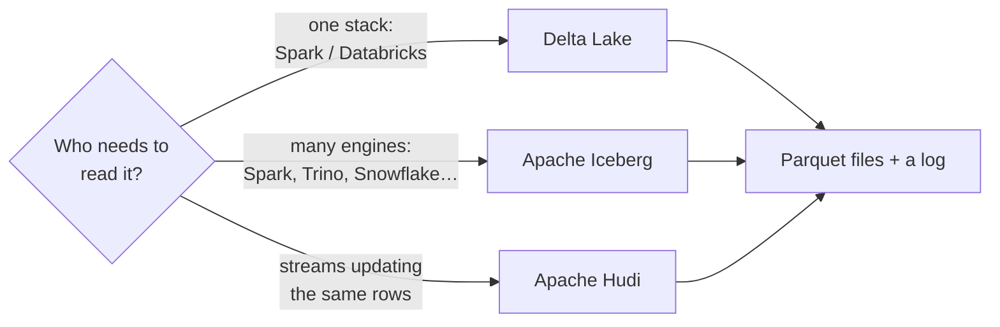

# Day 20 · Delta vs Iceberg vs Hudi

!!! abstract "In one line"
    Picking a table format because a blog called it "the best" leads to **format lock-in**: the engines you already use can't read it well. Don't ask "which is best?", ask **who needs to read it?** One stack on Spark/Databricks → **Delta Lake**. Many engines on one table → **Iceberg**. Constant updates to the same rows → **Hudi**. Underneath, all three are **Parquet files plus a log**.

<span class="dd-fix">Delta Lake</span> <span class="dd-fix">Apache Iceberg</span> <span class="dd-fix">Apache Hudi</span>

## The story: the "best" billing software 🧾

Raju's son bought **the best billing software**. Now nothing talks to it. That's **format lock-in**.

His friend said, "This one is number one!" So he bought it for **₹15,000**. But Raju's CA uses a different app, and the supplier uses another. Every month the son **re-types 300 bills**, and the CA charges **₹8,000 extra** just for the mess.

**In apps**, teams pick a table format because a blog said it's the best. Then the engines they already use can't read it well: pipelines break, data gets copied twice, bills double.

## Why it happens in real systems

| Choice | What it costs |
|---|---|
| Format picked from a blog / benchmark | Your engines may only partly support it (read-only, no MERGE, older spec) |
| Two formats for two teams | Same data copied twice, two pipelines, drift between copies |
| Reading table folders as plain Parquet | Old, deleted and rewritten files counted as live: wrong numbers |
| Copy-on-write for a heavily updated table | Whole files rewritten for a few changed rows |
| Catalog chosen as an afterthought | Iceberg tables are only as portable as the catalog your engines can reach |



## The problem in numbers

All three formats store data as ordinary Parquet files. What makes them a *table* is the **log** (Delta's `_delta_log`, Iceberg's metadata and manifests, Hudi's timeline) that says which files are live. An engine that doesn't speak that log sees only a folder of files.

The [code](https://github.com/datadukaan/datadukaan.github.io/tree/main/code/day-20-table-formats) writes **100,000 bills** into a real Delta table and a real Iceberg table, marks the CA's bills as paid in each, then reads both folders with and without the log.

??? example "Create the data (`make_data.py`)"
    ```python
    --8<-- "day-20-table-formats/make_data.py"
    ```

??? example "Read with and without the log (`03_who_can_read.py`)"
    ```python
    --8<-- "day-20-table-formats/03_who_can_read.py"
    ```

```text
how it was read                        rows    paid
Delta, read via its log             100,000  19,990
Delta folder as plain Parquet       200,000  19,990   <- wrong
Iceberg, read via catalog           100,000  19,990
Iceberg folder as plain Parquet     200,000  19,990   <- wrong
```

One update was enough: the folders hold old and new files side by side, so a reader that ignores the log **double-counts every bill**. That's what "nothing talks to it" looks like in data: the files are there, but the engine can't tell which ones count.

## Fix 1: One system? Delta Lake

**Raju:** if the whole shop runs on one system, use the software that system's people use.
**The app:** on Spark and Databricks, Delta Lake is the native format. Each commit is a JSON file in `_delta_log/` listing files **added** and **removed**; Days 16–18 built a tiny version of exactly this.

??? example "A real Delta table (`01_delta_table.py`)"
    ```python
    --8<-- "day-20-table-formats/01_delta_table.py"
    ```

```text
Folder:
part-00000-ab8ac4f4-…-c000.snappy.parquet  (924,669 B)
part-00000-b785292f-…-c000.snappy.parquet  (909,633 B)
_delta_log/
  00000000000000000000.json  (1,682 B)
  00000000000000000001.json  (1,230 B)

History:
  v0: WRITE
  v1: UPDATE

Last log file holds actions: ['add', 'commitInfo', 'remove']
Rows: 100,000 · paid: 19,990
```

| Good at | Watch out for |
|---|---|
| Deep Spark/Databricks integration, MERGE, OPTIMIZE, Z-order, liquid clustering | Outside Spark, support varies by engine and feature |
| Simple log you can read (JSON + checkpoints) | Table lives at a path; multi-engine access needs care |
| UniForm can also publish Iceberg metadata | Deletion vectors help updates but need reader support |

## Fix 2: Many tools? Iceberg

**Raju:** many people, many apps? Pick the one everyone can open.
**The app:** Iceberg was designed as an open spec for many engines (Spark, Trino, Flink, Snowflake, Athena, BigQuery, DuckDB…) to share **one table** through a **catalog**. Metadata is a tree: metadata JSON → manifest list → manifests → data files.

??? example "A real Iceberg table (`02_iceberg_table.py`)"
    ```python
    --8<-- "day-20-table-formats/02_iceberg_table.py"
    ```

```text
Folder:
catalog.db  (20,480 B)
shop/
  bills/
    data/
      00000-0-0904c177-26f…ce7e1b45ac00.parquet  (119,706 B)
      00000-0-5b88fe12-54b…c370f3f6412a.parquet  (445,885 B)
      00000-0-9fe21456-584…b879f93ca487.parquet  (558,122 B)
    metadata/
      00000-271ac9bb-9e9c-…c77712.metadata.json  (923 B)
      00001-588f2432-872a-…5718d1.metadata.json  (1,851 B)
      00002-04fde221-1663-…a826b5.metadata.json  (3,468 B)
      0904c177-26f8-4717-9e2c-ce7e1b45ac00-m0.avro  (4,568 B)
      5b88fe12-54b8-42d8-aeaa-c370f3f6412a-m0.avro  (4,588 B)
      5b88fe12-54b8-42d8-aeaa-c370f3f6412a-m1.avro  (4,586 B)
      9fe21456-584e-41a4-94d9-b879f93ca487-m0.avro  (4,582 B)
      snap-237941913915538…d9-b879f93ca487.avro  (1,823 B)
      snap-658937288877505…aa-c370f3f6412a.avro  (1,866 B)
      snap-820222617618136…2c-ce7e1b45ac00.avro  (1,904 B)
  …

Snapshots:
  2379419139155384409: append
  6589372888775058783: overwrite
  8202226176181365410: append

Rows: 100,000 · paid: 19,990
```

The catalog (here a SQLite file; in production REST, Glue, Hive, Polaris, Unity…) stores one pointer: the current metadata JSON. Every engine that reaches the catalog sees the same table.

| Good at | Watch out for |
|---|---|
| Widest multi-engine support, open spec | You must run or choose a catalog every engine can reach |
| Hidden partitioning, partition evolution | More metadata files to maintain (expire snapshots, rewrite manifests) |
| Copy-on-write or merge-on-read per table | Feature support differs between engines and spec versions |

## Fix 3: Constant updates? Hudi

**Raju:** bills changing all day? Pick the software built for constant edits.
**The app:** Hudi was built for **upserts**: streams fixing the same rows again and again. Its **merge-on-read** tables write updates to small log files and merge them into base files later (compaction), with record-level indexes to find rows fast.

Copy-on-write is the default way most tables update, and here is what it costs when the same rows change all day:

??? example "20 rounds of updates to the same 50 bills (`04_update_churn.py`)"
    ```python
    --8<-- "day-20-table-formats/04_update_churn.py"
    ```

```text
rows you changed   : 20 rounds x 50 bills = 1,000
rows rewritten     : 20 files x 100,000 = 2,000,000
Parquet rewritten  : 18.2 MB
table versions     : 21
```

**2,000 rows rewritten for every row changed.** Hudi MOR (and, more recently, Delta deletion vectors and Iceberg merge-on-read) avoid this by writing only the changes and merging on read or in a background compaction.

| Good at | Watch out for |
|---|---|
| High-rate upserts and CDC, record-level index | More moving parts: compaction, cleaning, table services |
| Incremental queries ("what changed since…") | Engine support is narrower than Iceberg's |
| MOR keeps write latency low | Reads of MOR tables merge logs (slower until compaction) |

## Bonus: you don't always have to choose one

The files underneath are Parquet in every case, so the metadata can be translated:

- **Delta UniForm** writes a Delta table and also publishes Iceberg metadata, so Iceberg readers can query it.
- **Apache XTable** (incubating) converts metadata between Delta, Iceberg and Hudi without copying the data.
- Engines keep converging: many now read more than one format.

## Where this lives in your tools

```sql
--8<-- "day-20-table-formats/platform_notes.sql"
```

## When to use what

| Situation | Approach |
|---|---|
| Everything runs on Databricks / Spark | Delta Lake |
| Spark writes, Trino / Snowflake / Athena also read | Iceberg with a shared catalog (or Delta + UniForm) |
| CDC or streams updating the same keys all day | Hudi MOR (or Delta deletion vectors / Iceberg MOR) |
| Engine already fixed by your platform | Use what it supports best; check MERGE, time travel and maintenance support |
| Undecided | List every engine that must read and write the table, then pick the format they all support well |

## Interview questions

??? question "What actually is a table format?"
    A metadata layer over data files (usually Parquet). It records which files make up each version of the table, the schema and partitioning, and commits changes atomically. That gives ACID transactions, time travel and safe concurrent writes on object storage.

??? question "Delta vs Iceberg vs Hudi in one line each?"
    Delta: Spark/Databricks-native, JSON transaction log. Iceberg: open, engine-neutral spec with a catalog and a metadata tree, widest multi-engine support. Hudi: built for upserts and incremental processing, with merge-on-read and record indexes.

??? question "Why is reading a table's folder directly as Parquet wrong?"
    Updates, deletes and compaction leave old files in place until vacuum or snapshot expiry. Only the log knows which files are live, so a plain Parquet read double-counts or includes deleted rows.

??? question "Copy-on-write vs merge-on-read?"
    Copy-on-write rewrites the affected data files on every update: fast reads, expensive writes. Merge-on-read writes small delete/log files and merges at read time or during compaction: cheap writes, slightly slower reads until compaction.

## Run it yourself

```bash
git clone https://github.com/datadukaan/datadukaan.github.io.git
cd datadukaan.github.io && pip install -r requirements.txt
cd code/day-20-table-formats
python make_data.py           # 100,000 bills
python 01_delta_table.py      # Fix 1: Delta table + _delta_log
python 02_iceberg_table.py    # Fix 2: Iceberg table + catalog
python 03_who_can_read.py     # read with and without the log
python 04_update_churn.py     # Fix 3: why update-heavy tables need MOR
```

## Further reading

- [Delta Lake documentation](https://docs.delta.io/latest/index.html)
- [Delta Lake: UniForm](https://docs.delta.io/latest/delta-uniform.html)
- [Apache Iceberg: table spec](https://iceberg.apache.org/spec/)
- [Apache Hudi: table types (COW vs MOR)](https://hudi.apache.org/docs/table_types)
- [Apache XTable](https://xtable.apache.org/)

---

*Watch the short version on [Instagram](https://instagram.com/datadukaan) or [YouTube](https://youtube.com/@datadukaan). Previous: [Day 19](day-19-compression-codecs.md). Next: [Day 21](day-21-distributed-processing.md).*
