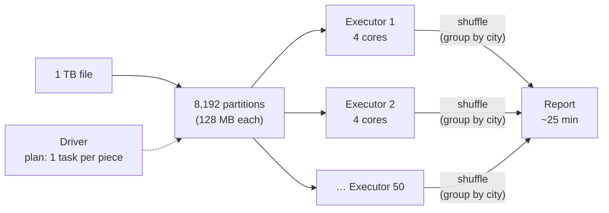

# Day 21 · Distributed processing (Spark)

!!! abstract "In one line"
    When one machine is too slow, don't buy a bigger one: **split the data into partitions**, let a **driver** plan one task per piece, and run the tasks on many **executors** at once. Watch out for the **shuffle** (data moving between machines for group-bys and joins), and relax about failures: Spark **re-runs just the failed task**.

<span class="dd-fix">partitions</span> <span class="dd-fix">driver</span> <span class="dd-fix">executors</span> <span class="dd-fix">shuffle</span> <span class="dd-fix">retry</span>

## The story: the interview question 🎤

> "You have a **1 TB** file. One machine takes **10 hours**. The report is due at **9 AM**. What do you do?"

Most candidates say "buy a bigger machine". **Rejected.** A bigger machine is expensive, has a ceiling, and is still one machine: if it dies at 3 AM, the whole night is lost.

The answer that gets the offer is the one Spark is built on: many ordinary machines working on pieces of the data at the same time. Raju's Diwali sales are the 1 TB file.

## Why one machine is not enough

| Approach | What happens |
|---|---|
| One machine, one core | Reads 1 TB row by row: ~10 hours |
| Bigger machine (scale up) | Faster, but costs rise steeply, there is a hard ceiling, and it's still a single point of failure |
| Many machines (scale out) | Work splits into thousands of small tasks; add machines to go faster |
| Many machines, careless code | A huge shuffle or one skewed key can make a cluster slower than expected |



## Step 1: Break it (partitions)

**Raju:** one cashier can't count a godown full of bills. Split the bills into bundles.
**The app:** Spark splits input files into **partitions** of up to `spark.sql.files.maxPartitionBytes` (128 MB by default). Each partition becomes one **task**. At real scale: 1 TB / 128 MB = **8,192 tasks**.

The [code](https://github.com/datadukaan/datadukaan.github.io/tree/main/code/day-21-distributed-processing) uses 4,000,000 orders (28 MB) as a small stand-in, and shrinks the piece size to show the effect.

??? example "Create the data (`make_data.py`)"
    ```python
    --8<-- "day-21-distributed-processing/make_data.py"
    ```

??? example "Piece size → tasks (`01_partitions.py`)"
    ```python
    --8<-- "day-21-distributed-processing/01_partitions.py"
    ```

```text
piece size 128 MB ->   2 partitions (= tasks in the first stage)
piece size   4 MB ->   8 partitions (= tasks in the first stage)
piece size   1 MB ->  32 partitions (= tasks in the first stage)

At real scale: 1 TB / 128 MB = 8,192 tasks
```

At 128 MB our small file still gets 2 partitions: Spark also splits by the number of cores so no core sits idle.

## Step 2 + 3: One boss, many workers (driver and executors)

**Raju:** one manager hands out bundles; many cashiers count at the same time.
**The app:** the **driver** turns your code into a plan of stages and tasks. **Executors** (processes on worker machines) run the tasks, one task per core at a time. 50 machines × 4 cores = **200 tasks at once**, so 8,192 tasks finish in about 41 rounds.

??? example "1 core vs all cores (`02_one_vs_many.py`)"
    ```python
    --8<-- "day-21-distributed-processing/02_one_vs_many.py"
    ```

```text
tasks per run      : 16
1 core             :  1.97 s  (tasks run one after another)
2 cores            :  1.33 s  (2 tasks at a time)
speed-up           : 1.5x
```

Our sandbox has 2 cores, so the best case is 2×; fixed costs (planning, scheduling, reading metadata) eat part of it. The same code on 200 cores is where "10 hours → ~25 minutes" comes from (a rough estimate: 10 h / 200 cores is 3 minutes of pure work, plus shuffle, scheduling and startup).

| Knob | What it controls |
|---|---|
| `--num-executors` / workers | How many machines |
| `--executor-cores` | Tasks each executor runs at once |
| `--executor-memory` | Memory per executor (too little → spills, out-of-memory, Day 25) |
| `maxPartitionBytes` | Input piece size → number of tasks |

## The trap: shuffle

**Raju:** "total sales by city?" Every Mumbai bill, from every cashier's bundle, has to be carried to **one** desk.
**The app:** a `groupBy`, `join`, `distinct` or window needs all rows with the same key in the same task. Spark writes them to disk, sends them **across the network**, and reads them on the other side: a **shuffle**. In the plan it appears as an **Exchange**. It's usually the slowest part of a job.

??? example "Which queries shuffle? (`03_shuffle.py`)"
    ```python
    --8<-- "day-21-distributed-processing/03_shuffle.py"
    ```

```text
filter + select  -> shuffle? False
groupBy(city)    -> shuffle? True

Physical plan for groupBy(city):
  *(2) HashAggregate(keys=[city#1], functions=[sum(amount#3L)], output=[city#1, total#5L])
  +- Exchange hashpartitioning(city#1, 8), ENSURE_REQUIREMENTS, [plan_id=35]
     +- *(1) HashAggregate(keys=[city#1], functions=[partial_sum(amount#3L)], output=[city
        +- *(1) ColumnarToRow
           +- FileScan parquet [city#1,amount#3L] Batched: true, DataFilters: [], Format: 

narrow job: 1.64 s · wide job (with shuffle): 1.79 s
top city: Mumbai ₹4,042,929,113
```

Note the `partial_sum` **before** the Exchange: Spark adds up each partition first, so only one small subtotal per city per task crosses the network. On one laptop the gap is small (no real network); on a cluster with 1 TB, the shuffle dominates. Shuffles get their own day (Day 24), and so does the case where Mumbai is so big that one task gets most of the work (data skew, Day 22).

## Retry: one machine dies at 3 AM

**Raju:** a cashier goes home sick. The manager gives **just that bundle** to someone else.
**The app:** Spark remembers how every partition was built (its **lineage**). When a task or executor fails, the driver re-runs only the lost tasks, up to `spark.task.maxFailures` (4) times.

??? example "A task fails and is re-run alone (`04_retry.py`)"
    ```python
    --8<-- "day-21-distributed-processing/04_retry.py"
    ```

```text
partition 0: attempt 1, sum   500,500
partition 1: attempt 1, sum 1,500,500
partition 2: attempt 1, sum 2,500,500
partition 3: attempt 2, sum 3,500,500  <- re-run (attempt 2)
partition 4: attempt 1, sum 4,500,500
partition 5: attempt 1, sum 5,500,500
partition 6: attempt 1, sum 6,500,500
partition 7: attempt 1, sum 7,500,500

grand total 32,004,000 (correct: 32,004,000)
```

## Where this lives in your tools

```sql
--8<-- "day-21-distributed-processing/platform_notes.sql"
```

## When to use what

| Situation | Approach |
|---|---|
| Data fits in one machine's memory (a few GB) | pandas / DuckDB / Polars on one machine is simpler and often faster |
| Hundreds of GB to TBs, daily batch | Spark (Databricks, EMR, Dataproc, Synapse) scaled out |
| Job too slow | Check the Spark UI: too few tasks? one giant task (skew)? huge shuffle? Then add executors |
| Warehouse SQL (Snowflake, BigQuery) | Same idea, managed for you: the engine splits and distributes the work |

## Interview questions

??? question "What are the driver and executors?"
    The driver runs your program, builds the logical and physical plan, splits it into stages and tasks, and schedules them. Executors are processes on worker nodes that run tasks (one per core at a time), cache data and send results back.

??? question "How many tasks will a stage have?"
    For a file scan, roughly total input size / `maxPartitionBytes` (128 MB), adjusted for the number of cores and file boundaries. After a shuffle, `spark.sql.shuffle.partitions` (200 by default), which AQE can merge or split at runtime.

??? question "What causes a shuffle, and how do you reduce it?"
    Wide operations: groupBy, join, distinct, repartition, window functions. Reduce it by filtering and selecting columns early, pre-aggregating, broadcasting small tables in joins (Day 23), and avoiding unnecessary repartitions.

??? question "Why scale out instead of up?"
    Scale-up has a hard ceiling, costs grow faster than performance, and one machine is a single point of failure. Scale-out adds commodity machines, and the framework tolerates individual failures by re-running tasks.

## Run it yourself

```bash
git clone https://github.com/datadukaan/datadukaan.github.io.git
cd datadukaan.github.io && pip install -r requirements.txt
cd code/day-21-distributed-processing
python make_data.py         # 4,000,000 orders
python 01_partitions.py     # piece size -> tasks
python 02_one_vs_many.py    # 1 core vs all cores
python 03_shuffle.py        # which queries shuffle
python 04_retry.py          # a failed task re-runs alone
```

## Further reading

- [Spark: cluster mode overview](https://spark.apache.org/docs/latest/cluster-overview.html)
- [Spark SQL: performance tuning (partitions, AQE)](https://spark.apache.org/docs/latest/sql-performance-tuning.html)
- [Spark: configuration (`spark.task.maxFailures`)](https://spark.apache.org/docs/latest/configuration.html)
- [Spark RDD guide: shuffle operations](https://spark.apache.org/docs/latest/rdd-programming-guide.html#shuffle-operations)

---

*Watch the short version on [Instagram](https://instagram.com/datadukaan) or [YouTube](https://youtube.com/@datadukaan). Previous: [Day 20](day-20-table-formats.md). Next: Day 22.*
